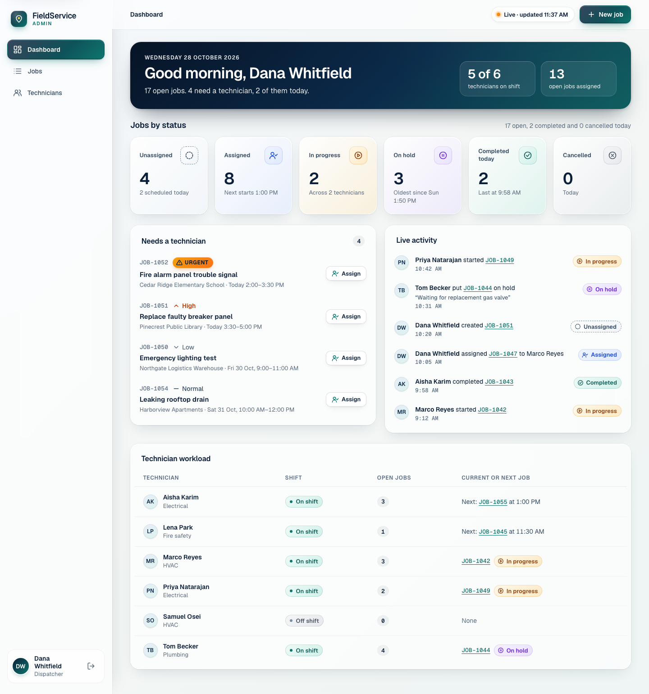
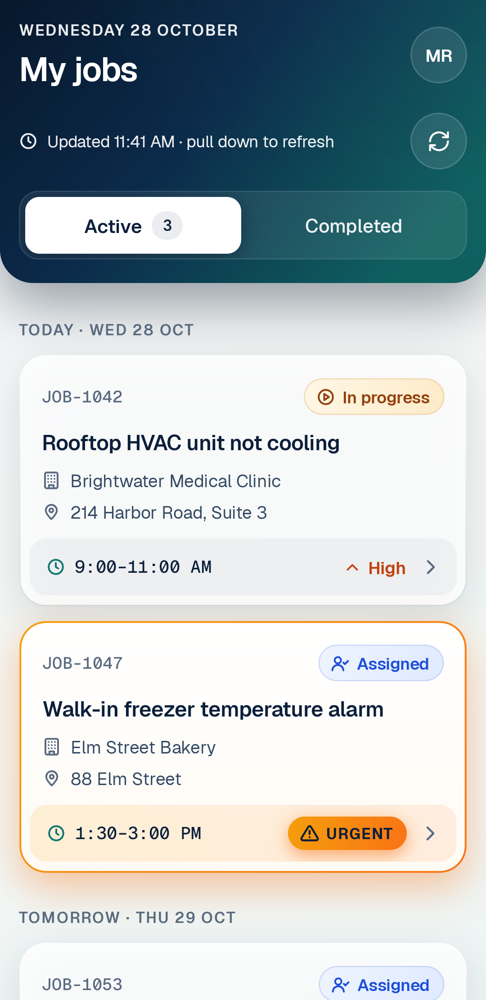
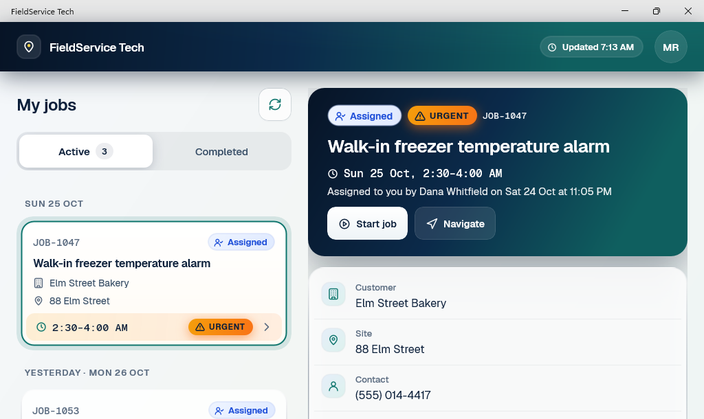

# FieldService

FieldService is a field service management system. Administrators create service jobs, assign them to technicians and follow their progress on a web dashboard. Technicians work through their jobs in an app on Android or Windows: they start a job, put it on hold or resume it, complete a checklist inspection on site and submit it. Every change reaches the dashboard in real time.

| Technician app on Android | Technician app on Windows |
|---|---|
|  |  |

## Features

- **Administrators:** sign in, a dashboard with status counts and live activity, a jobs list with filters, job creation, assignment and cancellation, job details with the status history, inspection reports, and a technicians page.
- **Technicians:** sign in, jobs grouped by day, job details with navigation to the site, status changes with a reason for each hold, a checklist inspection with readings and fault notes, and review and submit. The jobs list and an open job stay readable offline.
- **Real time:** status changes, assignments and new jobs appear on open dashboards within a second, without a reload.
- **Accessibility:** screen reader support with TalkBack on Android, Narrator on Windows and screen readers in the browser; full keyboard use; large text sizes.

## Applications

| Application | Folder | Technology | Role |
|---|---|---|---|
| API | `src/FieldService.Api` | ASP.NET Core 10 Minimal APIs, Entity Framework Core 10 | Jobs, assignments, status changes, inspections, authentication and authorization; sends job events to the notification service |
| Technician app | `src/FieldService.Mobile` | .NET MAUI 10, Android and Windows | Assigned jobs, status updates and inspections in the field |
| Administrator dashboard | `src/FieldService.Web` | Vue 3, TypeScript, Vite | Dashboard, job creation, assignment and cancellation, job list and details, inspection reports, technicians |
| Notification service | `src/FieldService.Notifications` | Node.js, TypeScript, Socket.IO | Verifies signed job events from the API and broadcasts them to the dashboard |
| Database | `infrastructure/postgres` | PostgreSQL 17 | The API's data, with separate roles for migrations and for the running API |

Each application has its own test suite: `tests/FieldService.Api.Tests` (including contract and security suites), `tests/FieldService.Mobile.Tests` and `tests/FieldService.Notifications.Tests`, plus colocated unit tests and Playwright end-to-end tests for the dashboard. The end-to-end tests also run against the full container stack on every pull request.

## Stack

| Area | Versions |
|---|---|
| .NET | SDK 10.0.402; ASP.NET Core and Entity Framework Core 10.0.13; Npgsql 10.0.3; Serilog 4.4; xUnit v3 |
| Technician app | .NET MAUI 10.0.110; CommunityToolkit.Mvvm 8.4.2 |
| Web | Node 26.12.0; TypeScript 6.0; Vue 3.5; Vite 8; Pinia; Vue Router; Vitest; Playwright |
| Notifications | Node 26.12.0; TypeScript 6.0; Socket.IO 4.8; pino 10; zod |
| Database | PostgreSQL 17.11 |
| Containers | Docker Compose, nginx |

## Architecture in brief

- Every application is organised by feature and use case ([ADR 0003](docs/decisions/0003-vertical-slice-architecture.md), [vertical-slices.md](docs/vertical-slices.md)); the API uses Minimal API slices without a mediator ([ADR 0004](docs/decisions/0004-minimal-api-slices-without-mediator.md)).
- The REST contract is the API's committed OpenAPI 3.1 document, `docs/contracts/openapi.v1.json`, and both clients are tested against it ([ADR 0011](docs/decisions/0011-openapi-snapshot-as-the-rest-contract.md)).
- The API connects to PostgreSQL with a role that cannot change the schema; migrations run with a separate role ([ADR 0005](docs/decisions/0005-postgresql-17-with-two-database-roles.md)).
- Job updates are protected by optimistic concurrency ([ADR 0006](docs/decisions/0006-optimistic-concurrency-with-xmin.md)).
- The API sends signed job events to the notification service, the dashboard connects to it with short-lived socket tickets, and every client refetches from the API instead of trusting an event ([ADR 0008](docs/decisions/0008-socket-tickets-for-the-notification-service.md), [ADR 0009](docs/decisions/0009-signed-webhooks-from-api-to-notifications.md), [ADR 0010](docs/decisions/0010-refetch-on-event-and-reconnect.md)).
- Each application writes structured logs with bounded retention, and one correlation id links a request across the applications ([ADR 0012](docs/decisions/0012-log-file-naming-and-retention.md)).

[architecture.md](docs/architecture.md) has the diagrams, each application's responsibilities and the request flows.

## Getting started

- [development.md](docs/development.md): prerequisites, the one-time creation of local secrets, and running the applications on macOS and Windows, directly or with Docker Compose.
- [demo.md](docs/demo.md): a guided walkthrough with the seeded demo accounts, and how to reset the demo data.

## Documentation

The [documentation index](docs/README.md) lists every document. The [decision records](docs/decisions/README.md) explain the main design choices, [security.md](docs/security.md) describes the security model and [limitations.md](docs/limitations.md) the known limits and the improvements planned next.

## Licence

FieldService is released under the [MIT License](LICENSE). Third-party components keep their own licences, listed in [third-party-notices.md](docs/third-party-notices.md); the Geist fonts are under the SIL Open Font License.
