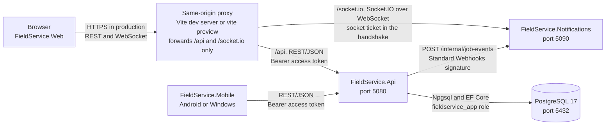
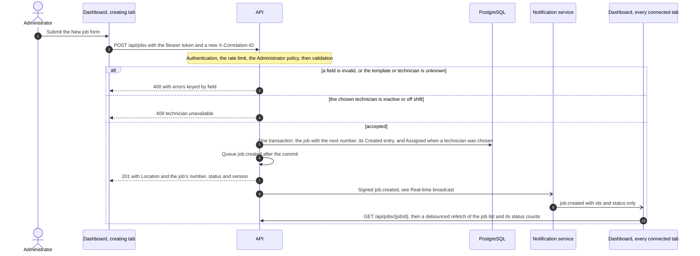
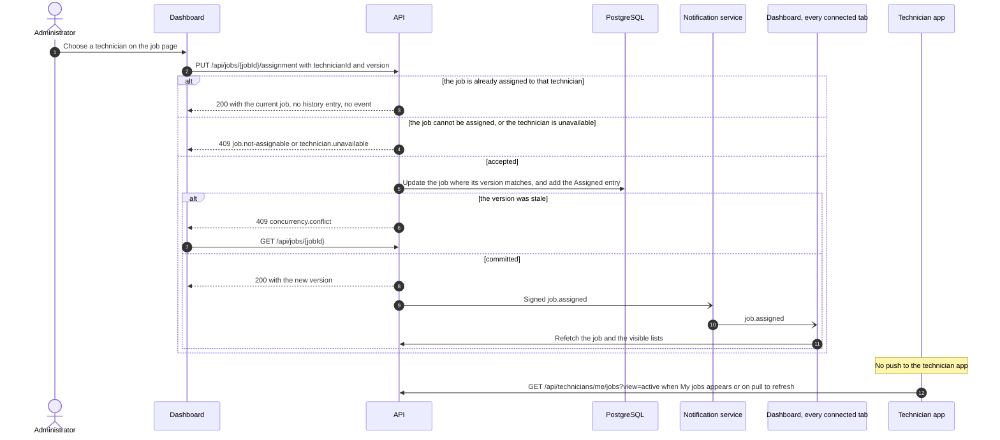
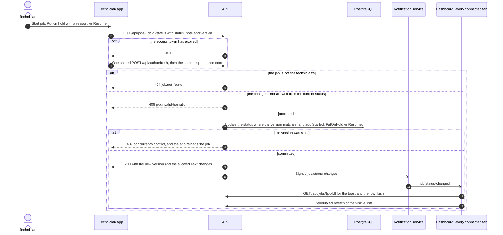
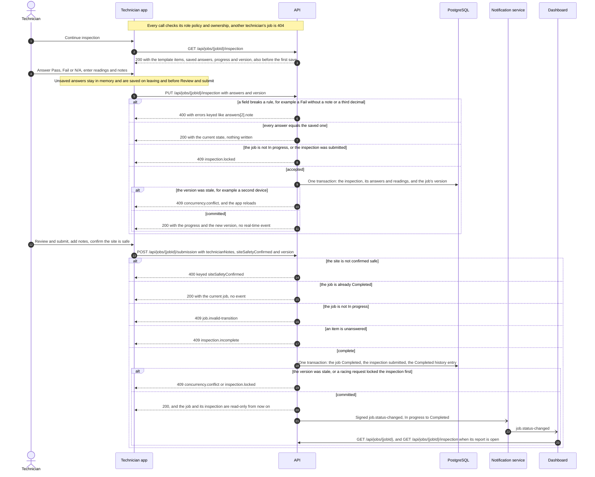
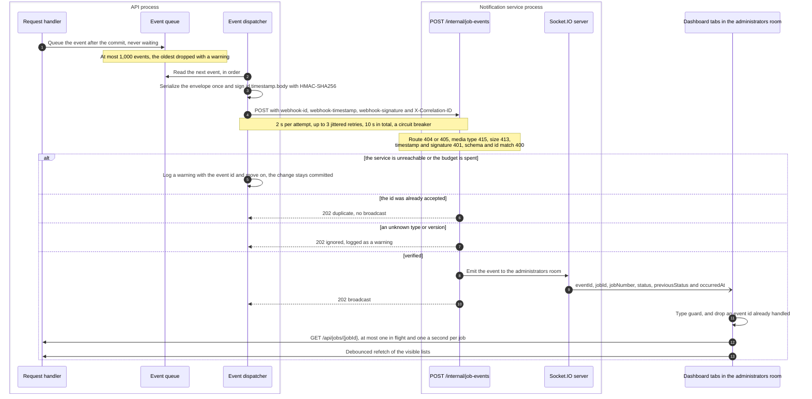
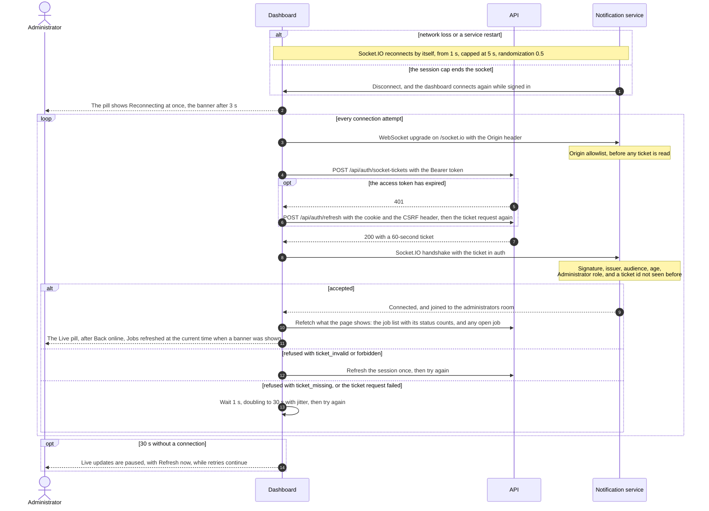

# Architecture

FieldService is a field service management system made of four applications and one database:

- **FieldService.Api**, an ASP.NET Core 10 API, owns every business rule and the only database connection.
- **FieldService.Web**, a Vue 3 dashboard for administrators (shown as dispatchers in the interface).
- **FieldService.Mobile**, a .NET MAUI app for technicians on Android and Windows.
- **FieldService.Notifications**, a Node.js service that relays job changes to the dashboard over Socket.IO.
- **PostgreSQL 17**, which only the API and its migrations reach.

This document currently covers how the applications communicate. The security controls on each connection are in [security.md](security.md), the wire formats in [contracts/README.md](contracts/README.md), and the settings in [configuration.md](configuration.md).

## Contents

- [Communication](#communication)
  - [Channels](#channels)
  - [Rules common to every flow](#rules-common-to-every-flow)
  - [Create a job](#create-a-job)
  - [Assign a job](#assign-a-job)
  - [Technician status update](#technician-status-update)
  - [Inspection save and submit](#inspection-save-and-submit)
  - [Real-time broadcast](#real-time-broadcast)
  - [Reconnect and refetch](#reconnect-and-refetch)

## Communication

### Channels

| From | To | Protocol | Authentication | Development address | Settings |
|---|---|---|---|---|---|
| Browser | Dashboard | HTTP | None | `http://localhost:5173` (Vite) | None |
| Dashboard | API | REST/JSON on the same origin, under `/api`, through the dev server's proxy | Bearer access token; on `/api/auth` only, the `fs_refresh` cookie with the header `X-FieldService-Csrf: 1` | Proxied to `http://127.0.0.1:5080` | `API_PROXY_TARGET` |
| Dashboard | Notification service | Socket.IO 4 over WebSocket only, under `/socket.io`, through the same proxy | A 60-second, single-use socket ticket in the handshake's `auth` member, fetched from the API for every handshake | Proxied to `http://127.0.0.1:5090` | `REALTIME_PROXY_TARGET`; the service's `SOCKET_ALLOWED_ORIGINS` and `SOCKET_TICKET_KEY` |
| Technician app | API | REST/JSON | Bearer access token; the refresh token in the body of the refresh and sign-out requests | `http://10.0.2.2:5080` from the Android emulator, `http://localhost:5080` on Windows; Release builds require `https` | `ApiBaseUrl` |
| API | Database | PostgreSQL protocol through Npgsql and EF Core | The `fieldservice_app` role, data changes only | `127.0.0.1:5432` | `ConnectionStrings:FieldService` |
| Migrations | Database | PostgreSQL protocol through `dotnet ef` | The `fieldservice_migrator` role, which owns the schema | `127.0.0.1:5432` | `ConnectionStrings:Migrations` |
| API | Notification service | HTTP `POST /internal/job-events` | Standard Webhooks HMAC-SHA256 signature | `http://127.0.0.1:5090` | `Notifications:BaseUrl` and `Notifications:WebhookSecret`; the service's `WEBHOOK_SECRETS` |

The `/internal` path and the health endpoints are never proxied to browsers. The technician app has no real-time channel: it reloads a list when its page appears and on pull to refresh, and the version check on every command catches a job that changed in the meantime.

### Rules common to every flow

- Every client request carries a new `X-Correlation-ID`. The API validates it, returns it, writes it to its logs and puts it in the job event, so one id links a user action, the API request, the signed event and the broadcast ([logging.md](logging.md)).
- Every error response from the API is Problem Details with a stable `code`, the correlation id and a trace id ([api.md](api.md)).
- Every job command carries the `version` the client last read. A stale version gets `409 concurrency.conflict`, and the client reloads the job. Repeating a command whose result already holds returns `200` with no new history entry and no event.
- Job events are queued only after the change commits, and they are hints: receivers refetch from the API and never copy data from an event ([ADR 0010](decisions/0010-refetch-on-event-and-reconnect.md)).

### Create a job

### Assign a job

### Technician status update

### Inspection save and submit

Saves send no event, because only the technician sees a draft. Every save that writes also updates the job row, so the job's version guards the checklist too, and two devices saving the same checklist cannot both succeed. Once submitted, the inspection cannot change: the API refuses the write, and a database trigger refuses any update or delete of a submitted inspection's rows. The administrator's read-only report is described in [ui.md](ui.md#inspection-report).

### Real-time broadcast

Requests never wait for the notification service, and a delivery failure never undoes a change. The service verifies, deduplicates and relays thin events; the dashboard treats each one as a hint and refetches from the API, with at most 60 event-driven requests a minute per tab. The design is recorded in [ADR 0009](decisions/0009-signed-webhooks-from-api-to-notifications.md).

### Reconnect and refetch

Every handshake uses a fresh ticket, and every successful connection refetches what the page shows, so events missed while disconnected never leave stale data on screen. The ticket design is recorded in [ADR 0008](decisions/0008-socket-tickets-for-the-notification-service.md), and the connection states in [ui.md](ui.md#live-updates).
