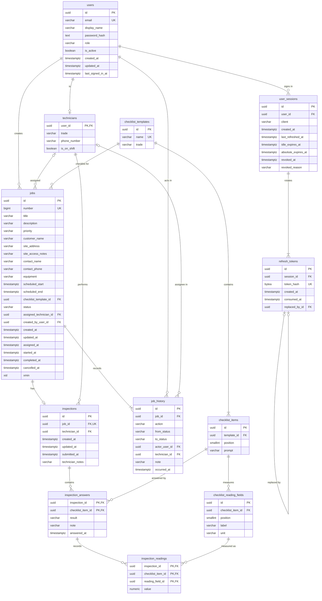

# Database

FieldService keeps its data in PostgreSQL 17.11. One database holds one schema, `fieldservice`, with twelve tables. Two login roles keep schema ownership apart from the running API: `fieldservice_migrator` owns every object and applies migrations, and `fieldservice_app` reads and writes rows. EF Core 10 with Npgsql maps the tables, and a single EF Core migration, `InitialSchema`, creates the whole schema together with its reference data.

- [Server and database](#server-and-database)
- [Roles and rights](#roles-and-rights)
- [Bootstrap script](#bootstrap-script)
- [Connection strings](#connection-strings)
- [Migration policy](#migration-policy)
- [Naming conventions](#naming-conventions)
- [Tables](#tables)
- [Reference data](#reference-data)
- [Demo data](#demo-data)

## Server and database

| Item | Value |
|---|---|
| Server | PostgreSQL 17.11 in every environment: Homebrew `postgresql@17` on 127.0.0.1:5432 for local development, the Compose `db` service (`postgres:17.11-trixie`) on host port 127.0.0.1:5433, and the same Compose service in CI. The API tests require major version 17. |
| Database | `fieldservice`, encoding UTF8, with the builtin locale provider and the locale `C.UTF-8`, so sorting and case mapping are identical on macOS, Linux and Windows. The database time zone is UTC. API test runs create `fieldservice_test_<run>` databases the same way. |
| Schema | `fieldservice` holds every object, the EF Core history table `"__EFMigrationsHistory"` included. Nothing is created in `public`. |
| Time | Every timestamp is `timestamp with time zone`, written in UTC by the API from an injected `TimeProvider`. The database defines no column defaults apart from the `jobs.number` identity. |

## Roles and rights

### Roles

| Role | Attributes | Role settings | Used by |
|---|---|---|---|
| `fieldservice_migrator` | LOGIN; NOSUPERUSER, NOCREATEDB, NOCREATEROLE, NOREPLICATION, NOBYPASSRLS | `lock_timeout = 10s`, `search_path = fieldservice` | `dotnet ef`, the migrations bundle (the Compose `migrate` service and the production release step), and the migration and data-reset steps of the API test fixture |
| `fieldservice_app` | LOGIN; the same five NO attributes; CONNECTION LIMIT 30 | `statement_timeout = 15s`, `lock_timeout = 5s`, `idle_in_transaction_session_timeout = 30s`, `search_path = fieldservice` | The running API, including the demo data seeder, and the API under test |

Why two roles:

- The running API cannot change the schema or rewrite the job history: it connects as a role that owns nothing and holds row privileges only.
- The API tests connect as `fieldservice_app`, so a missing or excessive grant fails a test instead of reaching an environment.
- The API never applies migrations. The EF Core tools, the test fixture, the migrations bundle and the production release step apply them as the migrator.

The migrator's 10-second lock timeout makes a migration that cannot get its lock fail fast instead of queueing every API query behind it. The app role's settings bound a runaway statement, a lock wait and an abandoned transaction. The API's connection pool (`Maximum Pool Size=20`) stays below the role's connection limit of 30.

### Privileges

| Object | `fieldservice_migrator` | `fieldservice_app` | PUBLIC |
|---|---|---|---|
| Database `fieldservice` (and each `fieldservice_test_<run>`) | Owner | CONNECT | Nothing: CONNECT and TEMPORARY revoked |
| Schema `fieldservice` | Owner | USAGE | Nothing |
| Schema `public` | Owner through `pg_database_owner` | USAGE only; no CREATE (the PostgreSQL 15 and later default) | USAGE |
| `users`, `technicians`, `user_sessions`, `refresh_tokens`, `jobs`, `inspections`, `inspection_answers`, `inspection_readings` | Owner | SELECT, INSERT, UPDATE, DELETE | Nothing |
| `job_history` | Owner | SELECT, INSERT (append-only) | Nothing |
| `checklist_templates`, `checklist_items`, `checklist_reading_fields` | Owner | SELECT | Nothing |
| `"__EFMigrationsHistory"` | Owner | SELECT, for the startup check for pending migrations | Nothing |
| Sequence `jobs_number_seq` | Owner | None: an identity insert needs no sequence privilege | Nothing |
| Function `advance_job_number()` | Owner; runs as the owner (`SECURITY DEFINER`) | EXECUTE | Nothing: EXECUTE revoked |
| Function `refuse_submitted_inspection_change()` | Owner | None: its triggers fire without EXECUTE on it, and it runs as the role that ran the statement (`SECURITY INVOKER`) | Nothing: EXECUTE revoked |
| Triggers `tr_inspections_submitted_lock`, `tr_inspection_answers_submitted_lock`, `tr_inspection_readings_submitted_lock` | Owner; exempt as a member of `fieldservice_migrator` | Bound by them: disabling, dropping or replacing them needs ownership, and `session_replication_role`, which would skip them, needs a superuser | Not applicable |
| TRUNCATE, REFERENCES, TRIGGER, DDL | Owner | None | None |

Where the privileges come from:

- The [bootstrap script](#bootstrap-script) creates the roles, the database and the schema, revokes CONNECT and TEMPORARY on the database from PUBLIC, and sets default privileges, so every table the migrator creates in `fieldservice` grants SELECT, INSERT, UPDATE and DELETE to `fieldservice_app`.
- `InitialSchema` narrows those defaults where a table needs it, creates the two functions and the three triggers, and revokes EXECUTE on each function from PUBLIC in the statement right after its `CREATE FUNCTION`. PostgreSQL grants EXECUTE on every new function to PUBLIC, and default privileges for tables do not cover functions.
- A later table gets row privileges automatically. A later migration adds grant statements only when a table needs a narrower grant, or when it creates a function.
- The API test fixture resets data as the migrator, because the app role holds neither DELETE nor TRUNCATE on `job_history`. The trigger exempts the migrator, and TRUNCATE fires no row triggers.

### Functions and triggers

`fieldservice.advance_job_number()` returns `bigint`. It is written in PL/pgSQL, owned by the migrator, declared `SECURITY DEFINER` with `SET search_path = fieldservice, pg_temp`, and only `fieldservice_app` may execute it. It compares the highest stored job number with the value the identity assigns next. When an explicitly inserted number has reached that value, it moves the sequence to the maximum, so the identity continues one above it; otherwise it changes nothing. It returns the next number the identity will assign. It never moves the sequence backwards, and the app role has no other way to move it. The demo data seeder calls it after inserting the seeded numbers JOB-1036 to JOB-1055, so the next job created is JOB-1056. Its fixed search path holds only `fieldservice`, where the app role cannot create objects, and then `pg_temp`, so nothing a caller creates can stand in for an object the function uses.

`fieldservice.refuse_submitted_inspection_change()` is a PL/pgSQL trigger function, `SECURITY INVOKER`, with the same fixed search path. It is attached `BEFORE UPDATE OR DELETE … FOR EACH ROW` as `tr_inspections_submitted_lock` on `inspections`, `tr_inspection_answers_submitted_lock` on `inspection_answers` and `tr_inspection_readings_submitted_lock` on `inspection_readings`. For every role that is not a member of `fieldservice_migrator` (superusers are members of every role), it refuses with SQLSTATE 55000 any update or delete of a submitted inspection, meaning one whose `submitted_at` is set, and of its answers and readings; clearing `submitted_at` is refused the same way. The API maps 55000 to 409 `inspection.locked`. Submission itself works, because the old row of a draft has no `submitted_at`, and any later change in the same transaction is refused. INSERT is not covered: the demo data seeder inserts submitted inspections as the app role, so only the API keeps rows from being added to a submitted inspection. The function checks only the old row, so the same holds for an update that moves a draft's answer or reading into a submitted inspection; the API never changes key columns.

`InitialSchema` creates both functions with the statements below, after every table and the identity sequence exist. Each `CREATE FUNCTION` is followed at once by its `REVOKE EXECUTE … FROM PUBLIC`, inside the same transaction, so no role other than the owner can call a function before its privileges are set. The migration runs as `fieldservice_migrator`, which therefore owns both functions.

```sql
CREATE FUNCTION fieldservice.advance_job_number() RETURNS bigint
LANGUAGE plpgsql
SECURITY DEFINER
SET search_path = fieldservice, pg_temp
AS $fn$
DECLARE
    highest bigint;
    next_number bigint;
BEGIN
    SELECT max(number) INTO highest FROM fieldservice.jobs;
    SELECT CASE WHEN is_called THEN last_value + 1 ELSE last_value END INTO next_number FROM fieldservice.jobs_number_seq;
    IF highest >= next_number THEN
        PERFORM setval('fieldservice.jobs_number_seq', highest);
        next_number := highest + 1;
    END IF;
    RETURN next_number;
END
$fn$;

REVOKE EXECUTE ON FUNCTION fieldservice.advance_job_number() FROM PUBLIC;

GRANT EXECUTE ON FUNCTION fieldservice.advance_job_number() TO fieldservice_app;

CREATE FUNCTION fieldservice.refuse_submitted_inspection_change() RETURNS trigger
LANGUAGE plpgsql
SECURITY INVOKER
SET search_path = fieldservice, pg_temp
AS $fn$
BEGIN
    IF NOT pg_has_role(current_user, 'fieldservice_migrator', 'MEMBER') THEN
        IF TG_TABLE_NAME = 'inspections' THEN
            IF OLD.submitted_at IS NOT NULL THEN
                RAISE EXCEPTION 'submitted inspection % cannot change', OLD.id USING ERRCODE = '55000';
            END IF;
        ELSIF EXISTS (SELECT FROM fieldservice.inspections WHERE id = OLD.inspection_id AND submitted_at IS NOT NULL) THEN
            RAISE EXCEPTION 'submitted inspection % cannot change', OLD.inspection_id USING ERRCODE = '55000';
        END IF;
    END IF;
    IF TG_OP = 'DELETE' THEN
        RETURN OLD;
    END IF;
    RETURN NEW;
END
$fn$;

REVOKE EXECUTE ON FUNCTION fieldservice.refuse_submitted_inspection_change() FROM PUBLIC;

CREATE TRIGGER tr_inspections_submitted_lock BEFORE UPDATE OR DELETE ON fieldservice.inspections FOR EACH ROW EXECUTE FUNCTION fieldservice.refuse_submitted_inspection_change();

CREATE TRIGGER tr_inspection_answers_submitted_lock BEFORE UPDATE OR DELETE ON fieldservice.inspection_answers FOR EACH ROW EXECUTE FUNCTION fieldservice.refuse_submitted_inspection_change();

CREATE TRIGGER tr_inspection_readings_submitted_lock BEFORE UPDATE OR DELETE ON fieldservice.inspection_readings FOR EACH ROW EXECUTE FUNCTION fieldservice.refuse_submitted_inspection_change();
```

- `advance_job_number()` reads the identity's sequence directly, which works because it runs as the sequence's owner. When the table is empty, `max(number)` is NULL, the comparison is not true, and the function returns the identity's next value without changing it.
- The trigger function returns `OLD` for a delete and `NEW` for an update, so a permitted statement proceeds unchanged. It needs no EXECUTE privilege for its triggers to fire.

## Bootstrap script

`infrastructure/postgres/bootstrap.sql` prepares a server for the migrations. It needs psql 15 or later and an admin connection: a superuser, or a role that can create roles and databases and is a member of `fieldservice_migrator`. It is idempotent: every run brings the roles, the database and the schema to the same state, so running it again repairs drift, including drifted passwords.

### Inputs

| Input | Source | Rule |
|---|---|---|
| `db_name` | psql variable (`-v db_name=…`), default `fieldservice` | Matches `^[a-z][a-z0-9_]{0,62}$` |
| `FIELDSERVICE_MIGRATOR_PASSWORD` | Environment variable, read with `\getenv` | At least 16 characters |
| `FIELDSERVICE_APP_PASSWORD` | Environment variable, read with `\getenv` | At least 16 characters |

The passwords never appear on a command line. A failed check raises an error before any role or database changes, and psql exits with status 3 under `ON_ERROR_STOP`.

### Steps

| Step | Statements | On a later run |
|---|---|---|
| 1. Validation | Checks `db_name` and both password lengths | The same checks |
| 2. Roles | `CREATE ROLE … LOGIN PASSWORD` for each missing role, then `ALTER ROLE` with the attributes, the password, the app role's connection limit, and `ALTER ROLE … SET` for each role setting | Creation is skipped; attributes, passwords and settings are applied again |
| 3. Database | When it is missing, `CREATE DATABASE` through `\gexec` with owner `fieldservice_migrator`, `TEMPLATE template0`, encoding UTF8, `LOCALE_PROVIDER builtin` and `BUILTIN_LOCALE 'C.UTF-8'`; then the owner, `timezone` set to UTC, `REVOKE CONNECT, TEMPORARY … FROM PUBLIC` and `GRANT CONNECT … TO fieldservice_app` | Creation is skipped; the rest is applied again |
| 4. Schema | `\connect` to the database; `CREATE SCHEMA IF NOT EXISTS fieldservice AUTHORIZATION fieldservice_migrator`; the owner; `REVOKE ALL … FROM PUBLIC`; `GRANT USAGE … TO fieldservice_app` | PostgreSQL prints a notice that the schema exists; the rest is applied again |
| 5. Default privileges | `ALTER DEFAULT PRIVILEGES FOR ROLE fieldservice_migrator IN SCHEMA fieldservice GRANT SELECT, INSERT, UPDATE, DELETE ON TABLES TO fieldservice_app` | No change |

### The three bootstrap paths

| Path | When | Command | Passwords |
|---|---|---|---|
| Compose `db` service | First start on an empty data volume | The image entrypoint runs the file, mounted as `/docker-entrypoint-initdb.d/10-bootstrap.sql`, as `POSTGRES_USER` (`postgres`) against `POSTGRES_DB` (`postgres`), with the default `db_name` | From the service environment |
| Local server (Homebrew on macOS, the PostgreSQL installer on Windows) | `node infrastructure/scripts/create-dev-env.mjs --bootstrap`, which the VS Code task `db: bootstrap local server` also runs | `psql -X -h 127.0.0.1 -p 5432 -U <admin> -d postgres -v ON_ERROR_STOP=1 -f infrastructure/postgres/bootstrap.sql` | In the environment of the psql child process; `PGPASSWORD` as well when the admin role has a password |
| API test fixture | Once per test run, for that run's database | `psql -X -v ON_ERROR_STOP=1 -v db_name=fieldservice_test_<run> -f infrastructure/postgres/bootstrap.sql`, with the admin connection in `PGHOST`, `PGPORT`, `PGUSER`, `PGPASSWORD` and `PGDATABASE` | The fixture reads `FIELDSERVICE_TEST_ADMIN_CONNECTION` and both passwords from the environment, then from the user-secrets store `fieldservice-api-tests`, and never creates them |

- **Compose.** `POSTGRES_DB` must stay `postgres`. Any other value makes the image create that database itself, owned by the superuser and with the libc locale.
- **Homebrew.** The superuser is the macOS account that installed PostgreSQL, and the server has no `postgres` role. Loopback connections use trust authentication, so local passwords are set but not checked.
- **Production.** A database administrator runs the file once per environment as a superuser, with both passwords as environment variables injected from the secret store. On a managed service, the provider's administrative role runs it after it has been granted membership in `fieldservice_migrator`, which `ALTER DATABASE … OWNER` and `ALTER DEFAULT PRIVILEGES FOR ROLE` require.

### Checking a bootstrap

These read-only queries, run as the admin role, show the state the script leaves. The first three read cluster-wide catalogs and run with `-d postgres`; the last two run in the bootstrapped database (`-d fieldservice`).

```sql
SELECT rolname, rolcanlogin, rolsuper, rolcreatedb, rolcreaterole, rolreplication, rolbypassrls, rolconnlimit FROM pg_roles WHERE rolname IN ('fieldservice_migrator', 'fieldservice_app') ORDER BY rolname;
SELECT r.rolname, s.setconfig FROM pg_db_role_setting s JOIN pg_roles r ON r.oid = s.setrole WHERE r.rolname IN ('fieldservice_migrator', 'fieldservice_app') ORDER BY r.rolname;
SELECT pg_get_userbyid(datdba), pg_encoding_to_char(encoding), datlocprovider, datlocale, datacl FROM pg_database WHERE datname = 'fieldservice';
SELECT nspname, pg_get_userbyid(nspowner), nspacl FROM pg_namespace WHERE nspname = 'fieldservice';
SELECT pg_get_userbyid(defaclrole), defaclobjtype, defaclacl FROM pg_default_acl;
```

| Check | Expected |
|---|---|
| Role attributes | Both roles can log in and have no SUPERUSER, CREATEDB, CREATEROLE, REPLICATION or BYPASSRLS; `rolconnlimit` is 30 for `fieldservice_app` and -1 (no limit) for `fieldservice_migrator` |
| Role settings | `fieldservice_app`: `{statement_timeout=15s,lock_timeout=5s,idle_in_transaction_session_timeout=30s,search_path=fieldservice}`; `fieldservice_migrator`: `{lock_timeout=10s,search_path=fieldservice}` |
| Database | Owner `fieldservice_migrator`, encoding UTF8, locale provider `b` (builtin), locale `C.UTF-8`, ACL `{fieldservice_migrator=CTc/fieldservice_migrator,fieldservice_app=c/fieldservice_migrator}`, which has no entry for PUBLIC; the database setting is `{TimeZone=UTC}` |
| Schema | Owner `fieldservice_migrator`, ACL `{fieldservice_migrator=UC/fieldservice_migrator,fieldservice_app=U/fieldservice_migrator}` |
| Default privileges | Role `fieldservice_migrator`, object type `r` (tables), `{fieldservice_app=arwd/fieldservice_migrator}`: INSERT, SELECT, UPDATE and DELETE |

## Connection strings

| Key | Role | Example (local Homebrew server) | Read by |
|---|---|---|---|
| `ConnectionStrings:FieldService` | `fieldservice_app` | `Host=127.0.0.1;Port=5432;Database=fieldservice;Username=fieldservice_app;Password=…;Maximum Pool Size=20;Application Name=fieldservice-api` | The API only |
| `ConnectionStrings:Migrations` | `fieldservice_migrator` | `Host=127.0.0.1;Port=5432;Database=fieldservice;Username=fieldservice_migrator;Password=…;Application Name=fieldservice-migrator` | The design-time factory of `dotnet ef` and the migrations bundle, never the running API |
| `FIELDSERVICE_TEST_ADMIN_CONNECTION` | A superuser | `Host=127.0.0.1;Port=5432;Database=postgres;Username=<admin>` | The API test fixture only |

- Connection strings come only from configuration: user-secrets in Development (`fieldservice-api` for the API and the EF Core tools, `fieldservice-api-tests` for the tests) and environment variables elsewhere.
- The Compose `db` service listens on host port 5433. Containers add `GSS Encryption Mode=Disable`, and production adds `SSL Mode=VerifyFull;Root Certificate=<CA path>`.
- `Application Name` makes sessions identifiable in `pg_stat_activity` and in the server log.
- `Include Error Detail` and EF Core sensitive-data logging stay off everywhere, and there is no retrying execution strategy.
- Per-environment values are in [configuration.md](configuration.md).

## Migration policy

### One migration for the MVP

`InitialSchema` builds the whole schema, and the MVP has no other migration. Its id is `20261020094242_InitialSchema`. It lives in `src/FieldService.Api/Persistence/Migrations/` (namespace `FieldService.Api.Persistence.Migrations`) as three files: `20261020094242_InitialSchema.cs`, `20261020094242_InitialSchema.Designer.cs` and `FieldServiceDbContextModelSnapshot.cs`. It is created with dotnet-ef 10.0.13 from the local tool manifest, `.config/dotnet-tools.json`, and records the product version `10.0.13` in `"__EFMigrationsHistory"`.

Applying it runs these steps, in this order:

1. Before the migration's transaction, EF Core creates schema `fieldservice` if it is missing (the bootstrap script normally has created it) and the history table `fieldservice."__EFMigrationsHistory"` (`migration_id` varchar(150), `product_version` varchar(32), primary key `pk___ef_migrations_history`) if it is missing. The table is owned by the migrator, so the default privileges first give the app role row privileges on it, which the migration narrows below.
2. In one transaction, the twelve tables, each after the tables it references: `checklist_templates`, `users`, `checklist_items`, `technicians`, `user_sessions`, `checklist_reading_fields`, `jobs`, `refresh_tokens`, `inspections`, `job_history`, `inspection_answers`, `inspection_readings`. Each `CREATE TABLE` carries the table's primary key, CHECK constraints and foreign keys; `checklist_reading_fields` also carries the alternate key.
3. The 58 rows of [reference data](#reference-data): 5 templates, 41 items and 12 reading fields.
4. The 23 indexes.
5. The statements added by hand, below.
6. The history row for `20261020094242_InitialSchema`, then the commit.

A failure rolls back every step after the transaction starts, so at most the schema and the empty history table remain.

The statements added by hand come in this order:

1. REVOKE INSERT, UPDATE and DELETE on `checklist_templates`, `checklist_items`, `checklist_reading_fields` and `"__EFMigrationsHistory"` from `fieldservice_app`, then GRANT SELECT on `"__EFMigrationsHistory"` to it;
2. REVOKE UPDATE and DELETE on `job_history` from `fieldservice_app`;
3. `advance_job_number()`, then REVOKE EXECUTE on it from PUBLIC and GRANT EXECUTE on it to `fieldservice_app`;
4. `refuse_submitted_inspection_change()`, then REVOKE EXECUTE on it from PUBLIC, then its three triggers.

The privilege statements of the first two steps:

```sql
REVOKE INSERT, UPDATE, DELETE ON fieldservice.checklist_templates, fieldservice.checklist_items, fieldservice.checklist_reading_fields FROM fieldservice_app;

REVOKE INSERT, UPDATE, DELETE ON fieldservice."__EFMigrationsHistory" FROM fieldservice_app;

GRANT SELECT ON fieldservice."__EFMigrationsHistory" TO fieldservice_app;

REVOKE UPDATE, DELETE ON fieldservice.job_history FROM fieldservice_app;
```

The statements of the last two steps are under [Functions and triggers](#functions-and-triggers). No other GRANT or REVOKE appears in the migration. Every object it creates is in schema `fieldservice`, no statement names `xmin`, and no statement carries an SQL comment.

The statements name both roles, so the bootstrap script must have run before the migration. Its `Down` starts with these statements and then drops the twelve tables, children before parents, and removes the history row:

```sql
DROP TRIGGER tr_inspection_readings_submitted_lock ON fieldservice.inspection_readings;
DROP TRIGGER tr_inspection_answers_submitted_lock ON fieldservice.inspection_answers;
DROP TRIGGER tr_inspections_submitted_lock ON fieldservice.inspections;
DROP FUNCTION fieldservice.refuse_submitted_inspection_change();
DROP FUNCTION fieldservice.advance_job_number();
```

The triggers and functions go first: a trigger function cannot be dropped while its triggers exist, and dropping a table does not drop a function that reads it. Dropping the tables removes their rows, the reference data included, and their grants. `Down` is for local use only; shared environments roll forward with a new migration.

### The SQL script

`dotnet ef migrations script --idempotent --project src/FieldService.Api` writes the migration as SQL, which is the form reviewed before a migration is merged and the form a production release can apply with psql. Inside the transaction, every statement is wrapped in a `DO $EF$ … $EF$;` block that runs only while `"__EFMigrationsHistory"` holds no row for `20261020094242_InitialSchema`, so running the script against a database that already has the migration changes nothing. The function bodies are quoted with `$fn$`, which nests inside `$EF$`. Without `--idempotent`, the command writes the same statements unwrapped. `dotnet ef migrations script InitialSchema 0 --project src/FieldService.Api` writes the `Down` statements. The files start with a UTF-8 byte-order mark, and the reference data holds non-ASCII units (`Ω`, `°F`).

### Applying migrations

The API never applies migrations. In Development and Staging it checks for pending migrations at startup, as the app role reading `"__EFMigrationsHistory"`, and stops with a message naming the command to run.

| Environment | Applied by | How | Connection |
|---|---|---|---|
| Development (Homebrew 5432 or Compose 5433) | Developer | `dotnet ef database update --project src/FieldService.Api`, or the VS Code task `db: migrate` | `ConnectionStrings:Migrations` from user-secrets `fieldservice-api` |
| Testing (API tests, locally and in CI) | The test fixture | `Database.MigrateAsync()` on a migrator connection to `fieldservice_test_<run>`, after the bootstrap script | Built from the admin connection's host and port and the migrator password |
| CI `api` job | Workflow | `dotnet ef migrations has-pending-model-changes --project src/FieldService.Api --configuration Release --no-build`, then the API tests against the Compose `db` service | A password-free migrator connection string for the model check, which never connects |
| Staging (Compose) | The `migrate` service | The migrations bundle; `api` starts once `migrate` has completed successfully | `ConnectionStrings__Migrations` in the service environment |
| Production | Release step | The same bundle, or the reviewed output of `dotnet ef migrations script --idempotent` applied with `psql -X -v ON_ERROR_STOP=1 -f <script>` as the migrator, without `--single-transaction`, because the script carries one transaction per migration | The migrator's credentials as environment variables of the release step, injected from the secret store |

The bundle is a self-contained `efbundle` for the container's architecture, built in the API Dockerfile and run without arguments. It reads `ConnectionStrings__Migrations` from the environment, so the password never appears on a command line, takes EF Core's migration lock, applies each migration in its own transaction, and exits 0 when nothing is pending. With PostgreSQL, the migration lock is `LOCK TABLE` on `"__EFMigrationsHistory"` in ACCESS EXCLUSIVE mode, so applying a migration creates no object besides those of the migration and the history table. While a migration runs, the API's startup check for pending migrations waits on that lock, up to the app role's 5-second lock timeout.

### Checking the applied schema

These read-only queries, run in the migrated database as the migrator or an admin role, show the state `InitialSchema` leaves. The `has_*_privilege` functions report a role's effective rights, and `public` stands for PUBLIC.

```sql
SELECT migration_id, product_version FROM fieldservice."__EFMigrationsHistory";
SELECT (SELECT count(*) FROM fieldservice.checklist_templates) AS templates, (SELECT count(*) FROM fieldservice.checklist_items) AS items, (SELECT count(*) FROM fieldservice.checklist_reading_fields) AS reading_fields;
SELECT contype, count(*) FROM pg_constraint WHERE connamespace = 'fieldservice'::regnamespace GROUP BY contype ORDER BY contype;
SELECT count(*) AS indexes, count(*) FILTER (WHERE i.indisunique) AS unique_indexes FROM pg_index i JOIN pg_class c ON c.oid = i.indrelid WHERE c.relnamespace = 'fieldservice'::regnamespace;
SELECT c.relname, has_table_privilege('fieldservice_app', c.oid, 'SELECT') AS sel, has_table_privilege('fieldservice_app', c.oid, 'INSERT') AS ins, has_table_privilege('fieldservice_app', c.oid, 'UPDATE') AS upd, has_table_privilege('fieldservice_app', c.oid, 'DELETE') AS del, has_table_privilege('fieldservice_app', c.oid, 'TRUNCATE') AS trunc, pg_get_userbyid(c.relowner) AS owner FROM pg_class c WHERE c.relnamespace = 'fieldservice'::regnamespace AND c.relkind = 'r' ORDER BY c.relname;
SELECT has_sequence_privilege('fieldservice_app', 'fieldservice.jobs_number_seq', 'USAGE') AS app_usage, has_sequence_privilege('fieldservice_app', 'fieldservice.jobs_number_seq', 'SELECT') AS app_select, has_sequence_privilege('fieldservice_app', 'fieldservice.jobs_number_seq', 'UPDATE') AS app_update, last_value, is_called FROM fieldservice.jobs_number_seq;
SELECT p.proname, pg_get_userbyid(p.proowner) AS owner, p.prosecdef, p.proconfig, has_function_privilege('fieldservice_app', p.oid, 'EXECUTE') AS app_execute, has_function_privilege('public', p.oid, 'EXECUTE') AS public_execute FROM pg_proc p WHERE p.pronamespace = 'fieldservice'::regnamespace ORDER BY p.proname;
SELECT c.relname, t.tgname, t.tgenabled FROM pg_trigger t JOIN pg_class c ON c.oid = t.tgrelid WHERE c.relnamespace = 'fieldservice'::regnamespace AND NOT t.tgisinternal ORDER BY t.tgname;
```

| Check | Expected |
|---|---|
| History | One row: `20261020094242_InitialSchema`, `10.0.13` |
| Reference rows | 5 templates, 41 items, 12 reading fields |
| Constraints by type | `c` (CHECK) 38, `f` (foreign key) 18, `p` (primary key) 13, `u` (unique) 1 |
| Indexes | 37 in all, 21 of them unique: 13 primary keys, the alternate key, 7 unique indexes and 16 further indexes |
| Table privileges of `fieldservice_app` | SELECT, INSERT, UPDATE and DELETE on `users`, `technicians`, `user_sessions`, `refresh_tokens`, `jobs`, `inspections`, `inspection_answers` and `inspection_readings`; SELECT and INSERT on `job_history`; SELECT only on the three checklist tables and `"__EFMigrationsHistory"`; TRUNCATE nowhere. Every table is owned by `fieldservice_migrator`. |
| Sequence `jobs_number_seq` | No USAGE, SELECT or UPDATE for `fieldservice_app`; before the first job, `last_value` 1001 and `is_called` false |
| Functions | Both owned by `fieldservice_migrator` with `proconfig` setting `search_path` to `fieldservice, pg_temp`. `advance_job_number`: `prosecdef` true, EXECUTE for `fieldservice_app`, none for PUBLIC. `refuse_submitted_inspection_change`: `prosecdef` false, no EXECUTE for `fieldservice_app` or PUBLIC. |
| Triggers | `tr_inspection_answers_submitted_lock` on `inspection_answers`, `tr_inspection_readings_submitted_lock` on `inspection_readings`, `tr_inspections_submitted_lock` on `inspections`, each with `tgenabled` `O` (enabled) |

The API tests prove the behaviour behind these rows as `fieldservice_app`: the denied statements fail with SQLSTATE 42501, and an update or delete of a submitted inspection's rows fails with 55000.

### Comment-free migration files

Migration files carry no comments. A design-time `CommentFreeMigrationsGenerator`, registered through `IDesignTimeServices`, removes the generator's header line and the documentation lines from the migration, designer and snapshot files, and trims the trailing comment from the `#pragma warning disable` line that `HasData` emits. `#nullable disable` and `#pragma` directives stay. `.editorconfig` marks `src/FieldService.Api/Persistence/Migrations/**` with `generated_code = true`. The comment scan in CI is the backstop, and the migration tests check the files as well.

### Adding a migration

```text
dotnet tool restore
dotnet ef migrations add AddSessionExpiryIndex --project src/FieldService.Api --output-dir Persistence/Migrations
dotnet ef migrations script InitialSchema AddSessionExpiryIndex --project src/FieldService.Api --idempotent --output artifacts/migrations/AddSessionExpiryIndex.sql
node infrastructure/scripts/check-no-comments.mjs
dotnet ef database update --project src/FieldService.Api
dotnet test --project tests/FieldService.Api.Tests
```

1. Change the entity and its configuration.
2. Add the migration. The comment-free generator runs automatically.
3. Add any `migrationBuilder.Sql(…)` grant statements by hand, without SQL comments.
4. Script the SQL into `artifacts/migrations/`, which git ignores, for review. The script starts from the last merged migration.
5. Run the comment scan.
6. Apply the migration locally as the migrator.
7. Add the migration to the history the migration tests expect, then run the API tests, which apply every migration to an empty per-run database.
8. Update this document in the same change.

An applied migration is never edited. A migration counts as applied as soon as anyone has run it, so a correction is always a new migration.

### Review checklist

Every migration's SQL script is reviewed against this list before it is merged:

1. Three files changed, with no comment lines.
2. The script matches the intent: types, nullability, defaults, constraint names of 63 characters or fewer, ON DELETE behaviour, index columns and sort order.
3. No operation touches `xmin`.
4. A new table that needs narrower privileges than the default row privileges carries its REVOKE or GRANT statements. A new function revokes EXECUTE from PUBLIC, and a `SECURITY DEFINER` function also sets `search_path = fieldservice, pg_temp`.
5. Destructive or blocking changes follow the change rules below.
6. `HasData` changes only add rows. A prompt, label or unit in use is never edited, because answers reference items by id and a reworded prompt would change past reports; a corrected checklist is a new template.
7. This document is updated.

### Change rules

| Change | Rule |
|---|---|
| New nullable column or new table | One migration |
| New required column on a populated table | Expand and contract: add it nullable, backfill, then add `NOT NULL` or a CHECK in a later migration |
| Rename or drop | Expand and contract across two releases: write both, switch reads, then drop; never in the same release as the code change that stops using the old name |
| New enumeration member | Replace the CHECK constraint in the migration that ships the member |
| Index on a large table | `migrationBuilder.Sql("CREATE INDEX CONCURRENTLY …", suppressTransaction: true)`, kept out of transactional migrations |
| Rollback | A forward fix in shared environments; `Down` stays for local use |

## Naming conventions

| Object | Convention | Example |
|---|---|---|
| Tables and columns | snake_case through `UseSnakeCaseNamingConvention()`; every entity names its table with `ToTable` | `JobHistoryEntry` maps to `job_history`, `CustomerName` to `customer_name` |
| Primary keys | `pk_<table>` | `pk_jobs` |
| Foreign keys | `fk_<table>_<principal table>_<columns>` | `fk_jobs_technicians_assigned_technician_id` |
| Alternate keys | `ak_<table>_<columns>` | `ak_checklist_reading_fields_checklist_item_id_id` |
| Indexes | `ix_<table>_<columns>` | `ix_jobs_status_updated_at_id` |
| Check constraints | `ck_<table>_<rule>`, always named explicitly | `ck_jobs_schedule` |
| Triggers | `tr_<table>_<rule>` | `tr_inspections_submitted_lock` |
| Functions | snake_case in schema `fieldservice` | `advance_job_number()` |
| Migrations | PascalCase, describing the change: `Add<Tables>`, `Add<Column>To<Table>`, `Create<Table>`, `Add<Purpose>Index`, `Change<Column>On<Table>` | `AddJobSearchTrigramIndexes`, `AddSessionExpiryIndex` |

- **Name length.** PostgreSQL truncates names at 63 characters, so a longer derived name gets an explicit `HasConstraintName`. The two composite foreign keys of `inspection_readings` are named `fk_inspection_readings_inspection_answers` and `fk_inspection_readings_checklist_reading_fields`.
- **Keys.** Every key is a UUIDv7 created in .NET with `Guid.CreateVersion7(timeProvider.GetUtcNow())` and mapped with `ValueGeneratedNever()`. Version-7 ids are time-ordered, so B-tree inserts append and `id` works as the tie-breaker in paging. `jobs.number` is `bigint GENERATED BY DEFAULT AS IDENTITY (START WITH 1001)`, shown as `JOB-1001`. A technician's key is their user id. Answers and readings use composite keys. Reference rows use fixed ids.
- **Enumerations.** Stored as `character varying(32)` holding the PascalCase member name, with a CHECK list per column, and no native PostgreSQL enum types, whose values cannot be dropped. The API's JSON uses the same names.
- **Text.** Required text is never blank, and optional text is NULL rather than blank; CHECK constraints enforce both.
- **Concurrency.** The system column `jobs.xmin` is mapped as `Version` (`uint`) and exposed as `version`. Migrations never create it.

| Columns | Values |
|---|---|
| `users.role` | `Administrator` (shown as Dispatcher), `Technician` |
| `technicians.trade`, `checklist_templates.trade` | `Hvac`, `Electrical`, `Plumbing`, `FireSafety` (shown as HVAC, Electrical, Plumbing, Fire safety) |
| `user_sessions.client` | `Web`, `Mobile` |
| `user_sessions.revoked_reason` | `SignOut`, `RefreshTokenReuse`, `UserInactive`, `Operator` |
| `jobs.priority` | `Low`, `Normal`, `High`, `Urgent` |
| `jobs.status`, `job_history.from_status`, `job_history.to_status` | `Unassigned`, `Assigned`, `InProgress`, `OnHold`, `Completed`, `Cancelled` |
| `job_history.action` | `Created`, `Assigned`, `Started`, `PutOnHold`, `Resumed`, `Completed`, `Cancelled` |
| `inspection_answers.result` | `Pass`, `Fail`, `NotApplicable` |

## Tables

| Table | Holds | Written by | Reference rows |
|---|---|---|---|
| `users` | Identity for administrators and technicians | The demo data seeder; sign-in (`last_signed_in_at`, password rehash); the operator runbook (`is_active`) | 0 |
| `technicians` | Trade, phone and shift of technician users | The demo data seeder | 0 |
| `user_sessions` | One row per sign-in: the refresh-token family | Sign-in, session refresh, sign-out; the operator runbook | 0 |
| `refresh_tokens` | SHA-256 hashes of rotating refresh tokens | Sign-in, session refresh | 0 |
| `checklist_templates` | The five immutable checklist templates | Migrations (`HasData`) | 5 |
| `checklist_items` | The items of each template, in order | Migrations (`HasData`) | 41 |
| `checklist_reading_fields` | The numeric readings an item asks for | Migrations (`HasData`) | 12 |
| `jobs` | Work orders: the aggregate root and the concurrency boundary | Job creation, assignment, status changes, submission, cancellation; inspection saves touch the row | 0 |
| `job_history` | Append-only state changes with actor and note | Every state-changing command | 0 |
| `inspections` | One checklist per job: a draft until submitted | Inspection saves and job submission | 0 |
| `inspection_answers` | Pass, Fail or NotApplicable per item | Inspection saves | 0 |
| `inspection_readings` | Numeric values per reading field | Inspection saves | 0 |

Integrity in numbers:

| Object | Count | Notes |
|---|---|---|
| Primary keys | 13 | One per table, plus `pk___ef_migrations_history` on the history table |
| Foreign keys | 18 | Each with explicit ON DELETE behaviour: 14 RESTRICT, 3 CASCADE (the answers and readings of an inspection, the tokens of a session), 1 SET NULL (a token's successor) |
| Alternate key | 1 | `ak_checklist_reading_fields_checklist_item_id_id`, a UNIQUE constraint |
| CHECK constraints | 38 | Listed with their expressions under each table below |
| Unique indexes | 7 | `ix_users_email`, `ix_refresh_tokens_token_hash`, `ix_checklist_templates_name`, `ix_checklist_items_template_id_position`, `ix_checklist_reading_fields_checklist_item_id_position`, `ix_jobs_number`, `ix_inspections_job_id` |
| Further indexes | 16 | Listed under each table below; three of them are descending |
| Trigger function and row triggers | 1 and 3 | `refuse_submitted_inspection_change()` on `inspections`, `inspection_answers` and `inspection_readings` |

Every name is 63 characters or fewer, so PostgreSQL truncates none; the longest, `fk_checklist_reading_fields_checklist_items_checklist_item_id`, has 61.

### Entity-relationship diagram



### Relationships and delete behaviour

| Child (columns) | Parent | ON DELETE | Constraint | Cardinality |
|---|---|---|---|---|
| `technicians (user_id)` | `users (id)` | RESTRICT | `fk_technicians_users_user_id` | User 1 : 0..1 technician (shared key) |
| `user_sessions (user_id)` | `users (id)` | RESTRICT | `fk_user_sessions_users_user_id` | User 1 : n sessions |
| `refresh_tokens (session_id)` | `user_sessions (id)` | CASCADE | `fk_refresh_tokens_user_sessions_session_id` | Session 1 : 1..n tokens |
| `refresh_tokens (replaced_by_id)` | `refresh_tokens (id)` | SET NULL | `fk_refresh_tokens_refresh_tokens_replaced_by_id` | Token 0..1 : 0..1 successor |
| `checklist_items (template_id)` | `checklist_templates (id)` | RESTRICT | `fk_checklist_items_checklist_templates_template_id` | Template 1 : 1..n items |
| `checklist_reading_fields (checklist_item_id)` | `checklist_items (id)` | RESTRICT | `fk_checklist_reading_fields_checklist_items_checklist_item_id` | Item 1 : 0..n fields |
| `jobs (checklist_template_id)` | `checklist_templates (id)` | RESTRICT | `fk_jobs_checklist_templates_checklist_template_id` | Template 1 : n jobs; required |
| `jobs (assigned_technician_id)` | `technicians (user_id)` | RESTRICT | `fk_jobs_technicians_assigned_technician_id` | Technician 0..1 : n jobs |
| `jobs (created_by_user_id)` | `users (id)` | RESTRICT | `fk_jobs_users_created_by_user_id` | User 1 : n jobs created |
| `job_history (job_id)` | `jobs (id)` | RESTRICT | `fk_job_history_jobs_job_id` | Job 1 : 1..n entries |
| `job_history (actor_user_id)` | `users (id)` | RESTRICT | `fk_job_history_users_actor_user_id` | User 1 : n entries |
| `job_history (technician_id)` | `technicians (user_id)` | RESTRICT | `fk_job_history_technicians_technician_id` | The assignee of an Assigned entry |
| `inspections (job_id)`, unique | `jobs (id)` | RESTRICT | `fk_inspections_jobs_job_id` | Job 1 : 0..1 inspection |
| `inspections (technician_id)` | `technicians (user_id)` | RESTRICT | `fk_inspections_technicians_technician_id` | Technician 1 : n inspections |
| `inspection_answers (inspection_id)` | `inspections (id)` | CASCADE | `fk_inspection_answers_inspections_inspection_id` | Inspection 1 : n answers |
| `inspection_answers (checklist_item_id)` | `checklist_items (id)` | RESTRICT | `fk_inspection_answers_checklist_items_checklist_item_id` | Item 1 : n answers |
| `inspection_readings (inspection_id, checklist_item_id)` | `inspection_answers` (same columns) | CASCADE | `fk_inspection_readings_inspection_answers` | Answer 1 : n readings |
| `inspection_readings (checklist_item_id, reading_field_id)` | `checklist_reading_fields (checklist_item_id, id)` | RESTRICT | `fk_inspection_readings_checklist_reading_fields` | Field 1 : n readings; the field belongs to the answered item |

The application never deletes rows: users are deactivated, jobs are cancelled, and the history is append-only. RESTRICT therefore only guards against mistakes. The cascades cover the owned children of an inspection and of a session.

### Table reference

Conventions for the column tables below: `varchar(n)` is `character varying(n)` and `timestamptz` is `timestamp with time zone`. No column has a database default except `jobs.number`. The API supplies every other value, timestamps included, so tests that control the clock control every stored time.

#### `users`

Identity for both roles. The interface labels an Administrator "Dispatcher".

| Column | Type | Null | Rules |
|---|---|---|---|
| `id` | uuid | NOT NULL | Primary key; UUIDv7 |
| `email` | varchar(256) | NOT NULL | Unique; stored lower-case invariant; at least one character on each side of `@` |
| `display_name` | varchar(100) | NOT NULL | Not blank |
| `password_hash` | text | NOT NULL | ASP.NET Core `PasswordHasher` version 3 output (PBKDF2 with HMAC-SHA512, 210,000 iterations), base64 |
| `role` | varchar(32) | NOT NULL | `Administrator` or `Technician` |
| `is_active` | boolean | NOT NULL | Inactive users fail sign-in and refresh |
| `created_at` | timestamptz | NOT NULL | |
| `updated_at` | timestamptz | NOT NULL | Not before `created_at` |
| `last_signed_in_at` | timestamptz | NULL | Set by a successful sign-in |

| Check constraint | Expression |
|---|---|
| `ck_users_display_name_not_blank` | `btrim(display_name) <> ''` |
| `ck_users_email_format` | `email LIKE '_%@_%'` |
| `ck_users_email_lower_case` | `email = lower(email)` |
| `ck_users_role` | `role IN ('Administrator', 'Technician')` |
| `ck_users_updated_at` | `updated_at >= created_at` |

| Index | Columns | Unique | Serves |
|---|---|---|---|
| `pk_users` | `id` | yes | Lookups by the token's subject; joins from every child |
| `ix_users_email` | `email` | yes | Sign-in by email, with the input lower-cased invariant |

#### `technicians`

The only target of an assignment, so only technicians can be assigned. The shift flag is seeded; the MVP has no toggle for it.

| Column | Type | Null | Rules |
|---|---|---|---|
| `user_id` | uuid | NOT NULL | Primary key and foreign key to `users.id`: a technician's id is their user id |
| `trade` | varchar(32) | NOT NULL | `Hvac`, `Electrical`, `Plumbing` or `FireSafety` |
| `phone_number` | varchar(32) | NOT NULL | Not blank; stored as displayed, for example `(555) 014-2231` |
| `is_on_shift` | boolean | NOT NULL | Assignment requires `true` and an active user |

| Check constraint | Expression |
|---|---|
| `ck_technicians_phone_number_not_blank` | `btrim(phone_number) <> ''` |
| `ck_technicians_trade` | `trade IN ('Hvac', 'Electrical', 'Plumbing', 'FireSafety')` |

| Index | Columns | Unique | Serves |
|---|---|---|---|
| `pk_technicians` | `user_id` | yes | Assignment checks; joins from jobs, history and inspections |

#### `user_sessions`

One row per sign-in: the refresh-token family of one client.

| Column | Type | Null | Rules |
|---|---|---|---|
| `id` | uuid | NOT NULL | Primary key; carried as the `sid` claim |
| `user_id` | uuid | NOT NULL | Foreign key to `users.id` |
| `client` | varchar(32) | NOT NULL | `Web` or `Mobile` |
| `created_at` | timestamptz | NOT NULL | |
| `last_refreshed_at` | timestamptz | NULL | NULL until the first refresh; not before `created_at` |
| `idle_expires_at` | timestamptz | NOT NULL | Web 60 minutes and Mobile 7 days after the last use, capped at the absolute expiry |
| `absolute_expires_at` | timestamptz | NOT NULL | Web 12 hours and Mobile 30 days after `created_at` |
| `revoked_at` | timestamptz | NULL | Set together with the reason |
| `revoked_reason` | varchar(32) | NULL | `SignOut`, `RefreshTokenReuse`, `UserInactive` or `Operator` |

| Check constraint | Expression |
|---|---|
| `ck_user_sessions_client` | `client IN ('Web', 'Mobile')` |
| `ck_user_sessions_expiry` | `idle_expires_at > created_at AND absolute_expires_at > created_at AND idle_expires_at <= absolute_expires_at` |
| `ck_user_sessions_last_refreshed_at` | `last_refreshed_at IS NULL OR last_refreshed_at >= created_at` |
| `ck_user_sessions_revocation` | `(revoked_at IS NULL) = (revoked_reason IS NULL)` |
| `ck_user_sessions_revoked_reason` | `revoked_reason IN ('SignOut', 'RefreshTokenReuse', 'UserInactive', 'Operator')` |

Revocation reasons: `SignOut` when the user signs out; `RefreshTokenReuse` when reuse detection revokes the session; `UserInactive` when a refresh arrives for an inactive user; `Operator` when an operator, connected as the migrator or a database administrator, revokes every live session of a user through the revocation runbook.

| Index | Columns | Unique | Serves |
|---|---|---|---|
| `pk_user_sessions` | `id` | yes | Session refresh (`SELECT … FOR UPDATE` on the token's session); sign-out |
| `ix_user_sessions_user_id` | `user_id` | no | Foreign-key support; a later sign-out everywhere or purge by user |

#### `refresh_tokens`

| Column | Type | Null | Rules |
|---|---|---|---|
| `id` | uuid | NOT NULL | Primary key |
| `session_id` | uuid | NOT NULL | Foreign key to `user_sessions.id`, cascading |
| `token_hash` | bytea | NOT NULL | SHA-256 of the 32-byte token, so exactly 32 bytes; unique. The token itself is never stored. |
| `created_at` | timestamptz | NOT NULL | |
| `consumed_at` | timestamptz | NULL | NULL while the token is live. Set by rotation, through a conditional update on `consumed_at IS NULL`, or by a grace-retry revocation. |
| `replaced_by_id` | uuid | NULL | Foreign key to `refresh_tokens.id`, set to NULL when the successor is deleted. Set only on a consumed token, and never to the token itself. |

| Check constraint | Expression |
|---|---|
| `ck_refresh_tokens_replacement` | `replaced_by_id IS NULL OR (consumed_at IS NOT NULL AND replaced_by_id <> id)` |
| `ck_refresh_tokens_token_hash_length` | `octet_length(token_hash) = 32` |

Token states: live when `consumed_at` is NULL; rotated when `consumed_at` and `replaced_by_id` are set; revoked by a grace retry when `consumed_at` is set and `replaced_by_id` is NULL.

| Index | Columns | Unique | Serves |
|---|---|---|---|
| `pk_refresh_tokens` | `id` | yes | The conditional rotation update; following `replaced_by_id` to the successor |
| `ix_refresh_tokens_token_hash` | `token_hash` | yes | Session refresh by token hash |
| `ix_refresh_tokens_session_id` | `session_id` | no | The cascade from `user_sessions`; tokens of a session |
| `ix_refresh_tokens_replaced_by_id` | `replaced_by_id` | no | Foreign-key support for SET NULL |

#### `checklist_templates`

Reference data with fixed ids, read-only to the app role.

| Column | Type | Null | Rules |
|---|---|---|---|
| `id` | uuid | NOT NULL | Primary key; fixed |
| `name` | varchar(120) | NOT NULL | Unique |
| `trade` | varchar(32) | NOT NULL | The same values as `technicians.trade`. The assign panel lists technicians of this trade first. |

| Check constraint | Expression |
|---|---|
| `ck_checklist_templates_trade` | `trade IN ('Hvac', 'Electrical', 'Plumbing', 'FireSafety')` |

| Index | Columns | Unique | Serves |
|---|---|---|---|
| `pk_checklist_templates` | `id` | yes | The template check of job creation; joins from jobs |
| `ix_checklist_templates_name` | `name` | yes | The template list, ordered by name |

#### `checklist_items`

| Column | Type | Null | Rules |
|---|---|---|---|
| `id` | uuid | NOT NULL | Primary key; fixed |
| `template_id` | uuid | NOT NULL | Foreign key to `checklist_templates.id` |
| `position` | smallint | NOT NULL | 1 to 99; unique per template; shown as "03 / 10" |
| `prompt` | varchar(200) | NOT NULL | |

| Check constraint | Expression |
|---|---|
| `ck_checklist_items_position` | `position BETWEEN 1 AND 99` |

| Index | Columns | Unique | Serves |
|---|---|---|---|
| `pk_checklist_items` | `id` | yes | Answer validation by item id |
| `ix_checklist_items_template_id_position` | `template_id, position` | yes | The items of a template in order: the inspection, the template list and the completeness check of job submission |

#### `checklist_reading_fields`

| Column | Type | Null | Rules |
|---|---|---|---|
| `id` | uuid | NOT NULL | Primary key; fixed |
| `checklist_item_id` | uuid | NOT NULL | Foreign key to `checklist_items.id` |
| `position` | smallint | NOT NULL | 1 to 9; unique per item |
| `label` | varchar(60) | NOT NULL | For example `Suction` |
| `unit` | varchar(16) | NOT NULL | For example `psi`, `°F`, `V` or `MΩ` |

| Check constraint | Expression |
|---|---|
| `ck_checklist_reading_fields_position` | `position BETWEEN 1 AND 9` |

| Index | Columns | Unique | Serves |
|---|---|---|---|
| `pk_checklist_reading_fields` | `id` | yes | Field lookups |
| `ix_checklist_reading_fields_checklist_item_id_position` | `checklist_item_id, position` | yes | The fields of an item in order |
| `ak_checklist_reading_fields_checklist_item_id_id` | `checklist_item_id, id` | yes (constraint) | The target of the composite reading foreign key, so the database guarantees that a reading belongs to a field of the answered item |

#### `jobs`

The aggregate root and the concurrency boundary.

| Column | Type | Null | Rules |
|---|---|---|---|
| `id` | uuid | NOT NULL | Primary key |
| `number` | bigint | NOT NULL | `GENERATED BY DEFAULT AS IDENTITY (START WITH 1001)`; unique; shown as `JOB-1001`. The demo data seeder inserts explicit numbers and then calls `advance_job_number()`. |
| `title` | varchar(120) | NOT NULL | Not blank |
| `description` | varchar(2000) | NOT NULL | Not blank |
| `priority` | varchar(32) | NOT NULL | `Low`, `Normal`, `High` or `Urgent` |
| `customer_name` | varchar(120) | NOT NULL | Not blank |
| `site_address` | varchar(300) | NOT NULL | Not blank |
| `site_access_notes` | varchar(500) | NULL | NULL or not blank |
| `contact_name` | varchar(100) | NULL | NULL or not blank |
| `contact_phone` | varchar(32) | NULL | NULL or not blank; the API validates the format |
| `equipment` | varchar(200) | NULL | NULL or not blank |
| `scheduled_start` | timestamptz | NOT NULL | |
| `scheduled_end` | timestamptz | NOT NULL | Later than `scheduled_start` |
| `checklist_template_id` | uuid | NOT NULL | Foreign key to `checklist_templates.id`; chosen at creation |
| `status` | varchar(32) | NOT NULL | `Unassigned`, `Assigned`, `InProgress`, `OnHold`, `Completed` or `Cancelled` |
| `assigned_technician_id` | uuid | NULL | Foreign key to `technicians.user_id`. NULL when Unassigned; set when Assigned, InProgress, OnHold or Completed; either when Cancelled. |
| `created_by_user_id` | uuid | NOT NULL | Foreign key to `users.id` |
| `created_at` | timestamptz | NOT NULL | |
| `updated_at` | timestamptz | NOT NULL | Not before `created_at`. Changed by every command, inspection saves included. |
| `assigned_at` | timestamptz | NULL | Set exactly when `assigned_technician_id` is set |
| `started_at` | timestamptz | NULL | Set on the first start; required for InProgress, OnHold and Completed, NULL for Unassigned and Assigned |
| `completed_at` | timestamptz | NULL | Set exactly when Completed; not before `started_at` |
| `cancelled_at` | timestamptz | NULL | Set exactly when Cancelled |
| `xmin` | xid (system column) | | Not created by migrations; mapped as `Version` and exposed as `version` |

| Check constraint | Expression |
|---|---|
| `ck_jobs_assigned_at` | `(assigned_technician_id IS NULL) = (assigned_at IS NULL)` |
| `ck_jobs_assignee` | `(status <> 'Unassigned' OR assigned_technician_id IS NULL) AND (status NOT IN ('Assigned', 'InProgress', 'OnHold', 'Completed') OR assigned_technician_id IS NOT NULL)` |
| `ck_jobs_cancelled_at` | `(status = 'Cancelled') = (cancelled_at IS NOT NULL)` |
| `ck_jobs_completed_at` | `(status = 'Completed') = (completed_at IS NOT NULL)` |
| `ck_jobs_optional_text_not_blank` | `(site_access_notes IS NULL OR btrim(site_access_notes) <> '') AND (contact_name IS NULL OR btrim(contact_name) <> '') AND (contact_phone IS NULL OR btrim(contact_phone) <> '') AND (equipment IS NULL OR btrim(equipment) <> '')` |
| `ck_jobs_priority` | `priority IN ('Low', 'Normal', 'High', 'Urgent')` |
| `ck_jobs_required_text_not_blank` | `btrim(title) <> '' AND btrim(description) <> '' AND btrim(customer_name) <> '' AND btrim(site_address) <> ''` |
| `ck_jobs_schedule` | `scheduled_end > scheduled_start` |
| `ck_jobs_started_at` | `CASE WHEN status IN ('InProgress', 'OnHold', 'Completed') THEN started_at IS NOT NULL WHEN status IN ('Unassigned', 'Assigned') THEN started_at IS NULL ELSE true END` |
| `ck_jobs_status` | `status IN ('Unassigned', 'Assigned', 'InProgress', 'OnHold', 'Completed', 'Cancelled')` |
| `ck_jobs_timestamps` | `updated_at >= created_at AND (completed_at IS NULL OR completed_at >= started_at)` |

| Index | Columns | Unique | Serves |
|---|---|---|---|
| `pk_jobs` | `id` | yes | Job details and every command |
| `ix_jobs_number` | `number` | yes | Uniqueness of job numbers. Search does not use it, because it matches `JOB-{number}` as a substring. |
| `ix_jobs_updated_at_id` | `updated_at DESC, id DESC` | no | The job list without a status filter, ordered by `updated_at DESC, id DESC` with offset paging |
| `ix_jobs_status_updated_at_id` | `status, updated_at DESC, id DESC` | no | The job list filtered by status; the status facet counts; the dashboard counts by status |
| `ix_jobs_assigned_technician_id_status` | `assigned_technician_id, status` | no | A technician's assigned jobs; the open-job counts and the current or next job per technician; the technician filter of the job list; foreign-key support |
| `ix_jobs_scheduled_start` | `scheduled_start` | no | Range and order on `scheduled_start` for the dashboard's unassigned-job queries at scale |
| `ix_jobs_checklist_template_id` | `checklist_template_id` | no | Foreign-key support |
| `ix_jobs_created_by_user_id` | `created_by_user_id` | no | Foreign-key support |

The job search matches the term with ILIKE against `'JOB-' || number::text`, the title, the customer name and the site address, which is a sequential scan at the MVP's size. Trigram indexes through `pg_trgm` are the planned optimization once the table grows.

#### `job_history`

Append-only: the app role has SELECT and INSERT only. It feeds the timelines, the dashboard's live activity and the time on site.

| Column | Type | Null | Rules |
|---|---|---|---|
| `id` | uuid | NOT NULL | Primary key |
| `job_id` | uuid | NOT NULL | Foreign key to `jobs.id` |
| `action` | varchar(32) | NOT NULL | `Created`, `Assigned`, `Started`, `PutOnHold`, `Resumed`, `Completed` or `Cancelled` |
| `from_status` | varchar(32) | NULL | A job status; NULL exactly for `Created` |
| `to_status` | varchar(32) | NOT NULL | Determined by the action: Created gives Unassigned, Assigned gives Assigned, Started and Resumed give InProgress, PutOnHold gives OnHold, Completed gives Completed, Cancelled gives Cancelled |
| `actor_user_id` | uuid | NOT NULL | Foreign key to `users.id` |
| `technician_id` | uuid | NULL | Foreign key to `technicians.user_id`; the assignee, set exactly for `Assigned` |
| `note` | varchar(500) | NULL | Required and not blank for `PutOnHold` and `Cancelled`, NULL otherwise |
| `occurred_at` | timestamptz | NOT NULL | The command's time; equal to the job's `updated_at` for that change |

| Check constraint | Expression |
|---|---|
| `ck_job_history_action` | `action IN ('Created', 'Assigned', 'Started', 'PutOnHold', 'Resumed', 'Completed', 'Cancelled')` |
| `ck_job_history_from_status` | `from_status IN ('Unassigned', 'Assigned', 'InProgress', 'OnHold', 'Completed', 'Cancelled')` |
| `ck_job_history_from_status_presence` | `(action = 'Created') = (from_status IS NULL)` |
| `ck_job_history_note` | `CASE WHEN action IN ('PutOnHold', 'Cancelled') THEN note IS NOT NULL AND btrim(note) <> '' ELSE note IS NULL END` |
| `ck_job_history_technician` | `(action = 'Assigned') = (technician_id IS NOT NULL)` |
| `ck_job_history_to_status` | `to_status = CASE action WHEN 'Created' THEN 'Unassigned' WHEN 'Assigned' THEN 'Assigned' WHEN 'Started' THEN 'InProgress' WHEN 'PutOnHold' THEN 'OnHold' WHEN 'Resumed' THEN 'InProgress' WHEN 'Completed' THEN 'Completed' WHEN 'Cancelled' THEN 'Cancelled' END` |

A job created with a technician gets two entries, `Created` and then `Assigned`.

| Index | Columns | Unique | Serves |
|---|---|---|---|
| `pk_job_history` | `id` | yes | |
| `ix_job_history_job_id_occurred_at` | `job_id, occurred_at` | no | Job timelines in job details and the inspection report; time on site |
| `ix_job_history_occurred_at` | `occurred_at DESC` | no | The dashboard's live activity: the 6 newest entries in the time window |
| `ix_job_history_actor_user_id` | `actor_user_id` | no | Foreign-key support |
| `ix_job_history_technician_id` | `technician_id` | no | Foreign-key support |

#### `inspections`

One per job: a draft until submitted, and immutable after submission, in the API and through `tr_inspections_submitted_lock` and its twins on the answers and readings.

| Column | Type | Null | Rules |
|---|---|---|---|
| `id` | uuid | NOT NULL | Primary key |
| `job_id` | uuid | NOT NULL | Foreign key to `jobs.id`; unique |
| `technician_id` | uuid | NOT NULL | Foreign key to `technicians.user_id`; the job's assignee at the first save |
| `created_at` | timestamptz | NOT NULL | The first save |
| `updated_at` | timestamptz | NOT NULL | The last save, or the submission |
| `submitted_at` | timestamptz | NULL | Set by job submission in the job's transaction; not before `created_at` |
| `technician_notes` | varchar(2000) | NULL | Only on a submitted inspection, and not blank |

| Check constraint | Expression |
|---|---|
| `ck_inspections_technician_notes` | `technician_notes IS NULL OR (submitted_at IS NOT NULL AND btrim(technician_notes) <> '')` |
| `ck_inspections_timestamps` | `updated_at >= created_at AND (submitted_at IS NULL OR submitted_at >= created_at)` |

The site-safety confirmation is not stored: submission rejects anything but `true`, so `submitted_at` implies it.

| Index | Columns | Unique | Serves |
|---|---|---|---|
| `pk_inspections` | `id` | yes | |
| `ix_inspections_job_id` | `job_id` | yes | Reading, saving and submitting by job id; one inspection per job |
| `ix_inspections_technician_id` | `technician_id` | no | Foreign-key support |

#### `inspection_answers`

| Column | Type | Null | Rules |
|---|---|---|---|
| `inspection_id` | uuid | NOT NULL | Primary key part; foreign key to `inspections.id`, cascading |
| `checklist_item_id` | uuid | NOT NULL | Primary key part; foreign key to `checklist_items.id` |
| `result` | varchar(32) | NOT NULL | `Pass`, `Fail` or `NotApplicable` |
| `note` | varchar(1000) | NULL | Required for `Fail`; NULL or not blank otherwise |
| `answered_at` | timestamptz | NOT NULL | Server time of the save that created or changed the answer |

| Check constraint | Expression |
|---|---|
| `ck_inspection_answers_note` | `(note IS NULL OR btrim(note) <> '') AND (result <> 'Fail' OR note IS NOT NULL)` |
| `ck_inspection_answers_result` | `result IN ('Pass', 'Fail', 'NotApplicable')` |

| Index | Columns | Unique | Serves |
|---|---|---|---|
| `pk_inspection_answers` | `inspection_id, checklist_item_id` | yes | The answers of an inspection; the upsert key |
| `ix_inspection_answers_checklist_item_id` | `checklist_item_id` | no | Foreign-key support |

#### `inspection_readings`

| Column | Type | Null | Rules |
|---|---|---|---|
| `inspection_id` | uuid | NOT NULL | Primary key part; with `checklist_item_id`, foreign key to `inspection_answers`, cascading (`fk_inspection_readings_inspection_answers`) |
| `checklist_item_id` | uuid | NOT NULL | Primary key part |
| `reading_field_id` | uuid | NOT NULL | Primary key part; with `checklist_item_id`, foreign key to `checklist_reading_fields (checklist_item_id, id)` (`fk_inspection_readings_checklist_reading_fields`) |
| `value` | numeric(10,2) | NOT NULL | From -99,999,999.99 to 99,999,999.99. The API rejects more than two decimals and out-of-range values, so PostgreSQL never rounds or overflows. |

| Index | Columns | Unique | Serves |
|---|---|---|---|
| `pk_inspection_readings` | `inspection_id, checklist_item_id, reading_field_id` | yes | The readings of an inspection with their answers |
| `ix_inspection_readings_checklist_item_id_reading_field_id` | `checklist_item_id, reading_field_id` | no | Foreign-key support for the composite field key |

### Rules the API enforces

These rules span rows or tables, so constraints cannot express them. The domain model enforces them, and the API tests cover them:

- An answer's item belongs to the job's checklist template.
- A Pass answer supplies a reading for every reading field of its item; a NotApplicable answer has none.
- Transition validity beyond the CHECK constraints, for example that `Started` follows only from Assigned.
- An assigned technician is active and on shift, and only users with the `Technician` role have a `technicians` row.
- The inspection's `technician_id` is the job's assignee.
- Completed and Cancelled jobs are read-only.
- A submitted inspection is immutable. The database backs this up for UPDATE and DELETE through the trigger; INSERT stays open to the app role.
- Email is lower-cased invariant before it is stored; the CHECK constraint only proves that it was.

## Reference data

The five checklist templates, with 41 items and 12 reading fields, are reference data: EF Core `HasData` in `Persistence/Seeding/ChecklistTemplateSeed.cs` writes them with fixed ids in `InitialSchema`, so the same 58 rows exist in every environment (Development, Testing, Staging and Production). The app role can only read them. A prompt, label or unit in use is never changed, because answers reference items by id; a corrected checklist becomes a new template, and template management is outside the MVP.

Demo data is separate. The demo data seeder writes demo users, jobs, history and inspections at API startup, in Development and Staging only and only when it is enabled; Production and the API tests never contain it. Sessions and refresh tokens are never seeded.

### Fixed ids

Every reference id is a valid UUIDv7 whose timestamp is 2026-10-19T00:00:00Z (`01a15175-3c00`), with version 7 and the RFC 9562 variant. The last group encodes the kind, the template code `TT`, the item position `II` and the field position `FF` as decimal digits:

| Kind | Pattern | Example |
|---|---|---|
| Template `TT` | `01a15175-3c00-7000-8000-0001TT000000` | Rooftop HVAC service: `01a15175-3c00-7000-8000-000102000000` |
| Item `II` of template `TT` | `01a15175-3c00-7000-8000-0002TTII0000` | Item 03 of Rooftop HVAC service: `01a15175-3c00-7000-8000-000202030000` |
| Field `FF` of item `II` of template `TT` | `01a15175-3c00-7000-8000-0003TTIIFF00` | Suction: `01a15175-3c00-7000-8000-000302030100` |

### Templates

| Code | Template | Id | Trade | Items | Reading fields |
|---|---|---|---|---|---|
| 01 | General electrical inspection | `01a15175-3c00-7000-8000-000101000000` | `Electrical` | 8 | 3 |
| 02 | Rooftop HVAC service | `01a15175-3c00-7000-8000-000102000000` | `Hvac` | 10 | 3 |
| 03 | Boiler service | `01a15175-3c00-7000-8000-000103000000` | `Plumbing` | 8 | 1 |
| 04 | Fire extinguisher inspection | `01a15175-3c00-7000-8000-000104000000` | `FireSafety` | 7 | 1 |
| 05 | Electrical panel inspection | `01a15175-3c00-7000-8000-000105000000` | `Electrical` | 8 | 4 |

- Items that measure live values come before isolation, and every template ends by restoring supply.
- Plumbing jobs use Boiler service, the only Plumbing template, and fire-safety jobs use Fire extinguisher inspection.
- The template list orders templates by name: Boiler service, Electrical panel inspection, Fire extinguisher inspection, General electrical inspection, Rooftop HVAC service.

### 01 General electrical inspection

| Position | Item id | Prompt | Reading fields |
|---|---|---|---|
| 01 | `01a15175-3c00-7000-8000-000201010000` | Measure supply voltage | 1: Supply voltage (V) |
| 02 | `01a15175-3c00-7000-8000-000201020000` | Isolate and lock out the circuits being worked on | None |
| 03 | `01a15175-3c00-7000-8000-000201030000` | Inspect wiring, terminations and enclosures | None |
| 04 | `01a15175-3c00-7000-8000-000201040000` | Test insulation resistance | 1: Insulation resistance (MΩ) |
| 05 | `01a15175-3c00-7000-8000-000201050000` | Test ground continuity | 1: Ground resistance (Ω) |
| 06 | `01a15175-3c00-7000-8000-000201060000` | Check fixtures, switches and receptacles | None |
| 07 | `01a15175-3c00-7000-8000-000201070000` | Label circuits and update the panel directory | None |
| 08 | `01a15175-3c00-7000-8000-000201080000` | Restore power and confirm normal operation | None |

### 02 Rooftop HVAC service

| Position | Item id | Prompt | Reading fields |
|---|---|---|---|
| 01 | `01a15175-3c00-7000-8000-000202010000` | Lock out and tag out unit power | None |
| 02 | `01a15175-3c00-7000-8000-000202020000` | Replace return air filters | None |
| 03 | `01a15175-3c00-7000-8000-000202030000` | Check refrigerant pressures | 1: Suction (psi); 2: Discharge (psi) |
| 04 | `01a15175-3c00-7000-8000-000202040000` | Clean condenser coil | None |
| 05 | `01a15175-3c00-7000-8000-000202050000` | Inspect condenser fan motor and bearings | None |
| 06 | `01a15175-3c00-7000-8000-000202060000` | Check belts and pulleys | None |
| 07 | `01a15175-3c00-7000-8000-000202070000` | Clear condensate drain line | None |
| 08 | `01a15175-3c00-7000-8000-000202080000` | Record supply air temperature | 1: Supply air temperature (°F) |
| 09 | `01a15175-3c00-7000-8000-000202090000` | Test thermostat and economizer controls | None |
| 10 | `01a15175-3c00-7000-8000-000202100000` | Restore power and confirm normal operation | None |

### 03 Boiler service

| Position | Item id | Prompt | Reading fields |
|---|---|---|---|
| 01 | `01a15175-3c00-7000-8000-000203010000` | Isolate gas and electrical supply | None |
| 02 | `01a15175-3c00-7000-8000-000203020000` | Inspect valves and fittings for leaks | None |
| 03 | `01a15175-3c00-7000-8000-000203030000` | Check system pressure | 1: System pressure (psi) |
| 04 | `01a15175-3c00-7000-8000-000203040000` | Test pressure relief valve | None |
| 05 | `01a15175-3c00-7000-8000-000203050000` | Inspect expansion tank | None |
| 06 | `01a15175-3c00-7000-8000-000203060000` | Check burner flame and combustion | None |
| 07 | `01a15175-3c00-7000-8000-000203070000` | Test low-water cutoff | None |
| 08 | `01a15175-3c00-7000-8000-000203080000` | Restore supply and confirm operation | None |

### 04 Fire extinguisher inspection

| Position | Item id | Prompt | Reading fields |
|---|---|---|---|
| 01 | `01a15175-3c00-7000-8000-000204010000` | Confirm each extinguisher is in its marked location | None |
| 02 | `01a15175-3c00-7000-8000-000204020000` | Check access is clear and signage is visible | None |
| 03 | `01a15175-3c00-7000-8000-000204030000` | Check the pressure gauge reads in the operable range | None |
| 04 | `01a15175-3c00-7000-8000-000204040000` | Inspect the pin, tamper seal and hose | None |
| 05 | `01a15175-3c00-7000-8000-000204050000` | Check for dents, corrosion or leakage | None |
| 06 | `01a15175-3c00-7000-8000-000204060000` | Weigh CO2 extinguishers | 1: Gross weight (lb) |
| 07 | `01a15175-3c00-7000-8000-000204070000` | Sign and date the inspection tag | None |

### 05 Electrical panel inspection

| Position | Item id | Prompt | Reading fields |
|---|---|---|---|
| 01 | `01a15175-3c00-7000-8000-000205010000` | Measure line voltage | 1: Line to line (V); 2: Line to neutral (V) |
| 02 | `01a15175-3c00-7000-8000-000205020000` | Measure load current | 1: Load current (A) |
| 03 | `01a15175-3c00-7000-8000-000205030000` | Check breaker temperatures under load | 1: Hottest breaker (°F) |
| 04 | `01a15175-3c00-7000-8000-000205040000` | Isolate the panel and verify it is de-energized | None |
| 05 | `01a15175-3c00-7000-8000-000205050000` | Inspect the enclosure, cover and circuit directory | None |
| 06 | `01a15175-3c00-7000-8000-000205060000` | Check breakers for heat damage and correct ratings | None |
| 07 | `01a15175-3c00-7000-8000-000205070000` | Torque-check lugs and terminations | None |
| 08 | `01a15175-3c00-7000-8000-000205080000` | Restore power and confirm normal operation | None |

### Reading fields

| Template | Item | Position | Field id | Label | Unit |
|---|---|---|---|---|---|
| General electrical inspection | 01 | 01 | `01a15175-3c00-7000-8000-000301010100` | Supply voltage | V |
| General electrical inspection | 04 | 01 | `01a15175-3c00-7000-8000-000301040100` | Insulation resistance | MΩ |
| General electrical inspection | 05 | 01 | `01a15175-3c00-7000-8000-000301050100` | Ground resistance | Ω |
| Rooftop HVAC service | 03 | 01 | `01a15175-3c00-7000-8000-000302030100` | Suction | psi |
| Rooftop HVAC service | 03 | 02 | `01a15175-3c00-7000-8000-000302030200` | Discharge | psi |
| Rooftop HVAC service | 08 | 01 | `01a15175-3c00-7000-8000-000302080100` | Supply air temperature | °F |
| Boiler service | 03 | 01 | `01a15175-3c00-7000-8000-000303030100` | System pressure | psi |
| Fire extinguisher inspection | 06 | 01 | `01a15175-3c00-7000-8000-000304060100` | Gross weight | lb |
| Electrical panel inspection | 01 | 01 | `01a15175-3c00-7000-8000-000305010100` | Line to line | V |
| Electrical panel inspection | 01 | 02 | `01a15175-3c00-7000-8000-000305010200` | Line to neutral | V |
| Electrical panel inspection | 02 | 01 | `01a15175-3c00-7000-8000-000305020100` | Load current | A |
| Electrical panel inspection | 03 | 01 | `01a15175-3c00-7000-8000-000305030100` | Hottest breaker | °F |

## Demo data

The demo data seeder writes one fixed data set: a dispatcher, six technicians, 20 jobs with 49 history entries, and three inspections. It gives the web dashboard and the technician app realistic content in development and in the Compose demo. Production and the API tests never contain it, and sessions and refresh tokens are never seeded.

### When the seeder runs

`Persistence/Seeding/DemoDataSeeder.cs` holds the seeder and `Persistence/Seeding/DemoData.cs` the data. The API runs the seeder at startup, after its check for pending migrations and before it starts listening, as `fieldservice_app` like every other API query. It writes only when all of these hold:

| Condition | Rule |
|---|---|
| Enabled | `Seed:DemoData` is `true`, as in Development and in the Compose stack |
| Environment | Not Production. Production refuses `Seed:DemoData=true` at startup, and the API tests build their own data |
| Password | `Seed:DemoPassword` holds 12 or more characters. Every demo account uses it; the value comes from the local configuration, never from the repository (see [configuration.md](configuration.md)) |
| Empty database | `users` has no rows. On a database that has users the seeder writes nothing. It never extends or repairs a seeded database, so it keeps no markers |
| One run at a time | One transaction covers the whole run and begins with `SELECT pg_advisory_xact_lock(20261019)`, so two API instances cannot seed at once and a failure leaves no partial data |

A skipped run logs one Information event naming the reason. A completed run logs one Information event with row counts only, never names, email addresses, phone numbers or addresses.

### How the rows are written

The seeder replays each job's history and the inspection saves in time order through the domain methods that the API commands use. Each call receives its event's time, so every seeded row passes the same domain rules and the same constraints as live data: the transitions of each job are valid, every assignee is an active technician on shift, notes appear exactly on `PutOnHold` and `Cancelled` entries, and every inspection answer belongs to the job's checklist template. Ids are UUIDv7 values created from the event's time, and each password hash is computed from `Seed:DemoPassword` with its own salt.

| Domain step | Rows |
|---|---|
| User and technician creation | 7 users, 6 technicians |
| Job creation | 20 jobs with their numbers and creation times; 20 `Created` entries |
| Assignment | 16 `Assigned` entries; `assigned_technician_id` and `assigned_at` |
| Starting and putting on hold | 7 `Started` and 3 `PutOnHold` entries; `started_at`. No job is resumed |
| Inspection saves | 3 inspections, 22 answers and 6 readings; each save also moves the job's `updated_at` |
| Submission | JOB-1039 and JOB-1043 completed, each with its inspection submitted in the same step; 2 `Completed` entries; `completed_at` |
| Cancellation | JOB-1036 cancelled; 1 `Cancelled` entry; `cancelled_at` |

The seeder sets the job numbers JOB-1036 to JOB-1055 explicitly. After the inserts, in the same transaction, it runs `SELECT fieldservice.advance_job_number()`, which moves the `jobs.number` identity past JOB-1055, so the first job created afterwards is JOB-1056. The numbers do not follow creation order: JOB-1039 and JOB-1051 were created on the seeding day, after JOB-1048 and JOB-1053. The lists order jobs by time and use the number only as a tie-breaker.

| Table | Rows after the seed |
|---|---|
| `users` | 7 |
| `technicians` | 6 |
| `jobs` | 20 |
| `job_history` | 49 |
| `inspections` | 3 |
| `inspection_answers` | 22 |
| `inspection_readings` | 6 |
| `user_sessions`, `refresh_tokens` | 0 |

The checklist tables keep their 58 reference rows; the seeder only reads them.

### Dates relative to the seeding day

The data describes a working Monday at 10:42 in the morning. The seeder places it on the day it runs, with the API's clock and local time zone:

- `D` is the local date when the seeder runs; `D-1` is the day before and `D+1` the day after.
- `Δ` is the whole number of hours, rounded down, that have passed between 10:42 local time on `D` and the moment the seeder runs. It is negative before 10:42.
- Each seeded time is its listed local time on its own day, converted to UTC with the local time zone, plus `Δ` hours. One anchor serves the whole run.
- A listed time that a daylight-saving change skips is converted with the UTC offset of the day before, so it moves forward by the length of the skipped interval. A listed time that occurs twice, when the clocks go back, is read as standard time, the later of the two. Every listed time falls between 06:58 and 17:00, outside the hours in which time zones usually change their clocks.

Before it writes anything, the seeder checks that the history entries, inspection saves and submission of each job follow one another strictly in time. If a time zone's rules ever broke that order, the seeder would write nothing and the API would stop at startup with a message naming the job and the two steps; started again at another time of day, it seeds normally. The API tests check every daylight-saving change from October 2026 to September 2027 in New York, Berlin, Sydney and Santiago, for seeds between 02:42 and 19:41 on each day from four days before a change to three days after it, and the order holds in all of them.

The tables below give times as `D`, `D-1` and so on, on the 24-hour local clock before the `Δ` shift. As a result:

- The newest event, JOB-1049 started, is 0 to 59 minutes old when the seeder finishes. Two events on the same side of a daylight-saving change are as far apart as their listed times.
- A seed run between 10:42 and 11:41 local shows the listed clock times exactly, also around a daylight-saving change.
- The figures that count the seeding day, such as the jobs completed today, hold when the seed runs between 02:42 and 19:41 local and the screens are read the same day. Outside that range, a completion or a scheduled start leaves the seeding day. On the day the clocks go forward, a seed run before 03:42 also moves the completion of JOB-1039 onto the day before, so the seeding day shows one completed job instead of two.
- When a daylight-saving change falls between a listed time and the moment `Δ` moves it to, the screens show that event earlier or later than its listed time plus `Δ` by the size of the change, one hour in most time zones. The order of events stays as listed.
- Seeded times are fixed when the seed runs. A demo on a later day shows the data as of the seeding day; a database reset places it on the current day again (see [Resetting the demo data](#resetting-the-demo-data)).
- In containers the local time zone is UTC unless `TZ` is set. Relative times still hold, and only the displayed hours shift.

### Users

Every account is active, uses `Seed:DemoPassword`, was created at D-30 09:00, and has not signed in yet (`last_signed_in_at` is NULL). The `example` domain is reserved for documentation, so no address reaches a real mailbox.

| Name | Email | Role | Trade | Phone | Shift |
|---|---|---|---|---|---|
| Dana Whitfield | `dana.whitfield@fieldservice.example` | Administrator, shown as Dispatcher | — | — | — |
| Marco Reyes | `marco.reyes@fieldservice.example` | Technician | `Hvac` (HVAC) | (555) 014-2231 | On shift |
| Aisha Karim | `aisha.karim@fieldservice.example` | Technician | `Electrical` (Electrical) | (555) 014-7810 | On shift |
| Tom Becker | `tom.becker@fieldservice.example` | Technician | `Plumbing` (Plumbing) | (555) 014-3392 | On shift |
| Lena Park | `lena.park@fieldservice.example` | Technician | `FireSafety` (Fire safety) | (555) 014-5521 | On shift |
| Priya Natarajan | `priya.natarajan@fieldservice.example` | Technician | `Electrical` (Electrical) | (555) 014-6604 | On shift |
| Samuel Osei | `samuel.osei@fieldservice.example` | Technician | `Hvac` (HVAC) | (555) 014-9148 | Off shift |

Samuel Osei is off shift, so he cannot be assigned; the other five technicians can.

### Jobs

Dana Whitfield created every job. The Scheduled column gives the day with the local start and end times, and Updated is `updated_at`, which follows from the history and the inspection saves.

| Job | Title | Customer | Site | Priority | Checklist template | Status | Technician | Scheduled | Updated |
|---|---|---|---|---|---|---|---|---|---|
| JOB-1036 | Office AC filter replacement | Summit Coworking | 12 Summit Plaza, Floor 4 | Low | Rooftop HVAC service | Cancelled | Marco Reyes | D-3 14:00–15:00 | D-3 09:20 |
| JOB-1037 | Annual boiler service | Harborview Apartments | 600 Bayfront Avenue | Normal | Boiler service | OnHold | Tom Becker | D-3 13:00–15:00 | D-3 13:50 |
| JOB-1038 | Hot water pressure relief valve dripping | St. Anne's Care Home | 75 Willow Lane | High | Boiler service | OnHold | Tom Becker | D-3 15:30–17:00 | D-3 16:25 |
| JOB-1039 | Boiler pressure drop | Lakeside Dental | 9 Lakeside Court | High | Boiler service | Completed | Tom Becker | D 07:00–08:30 | D 08:52 |
| JOB-1040 | Dock leveler outlet not working | Northgate Logistics Warehouse | 42 Industrial Parkway, Dock 4 | Normal | General electrical inspection | Assigned | Aisha Karim | D+1 13:00–14:30 | D-3 14:25 |
| JOB-1041 | Kitchen outlets tripping the GFCI | Elm Street Bakery | 88 Elm Street | High | General electrical inspection | Assigned | Aisha Karim | D+2 07:00–08:30 | D-2 09:35 |
| JOB-1042 | Rooftop HVAC unit not cooling | Brightwater Medical Clinic | 214 Harbor Road, Suite 3 | High | Rooftop HVAC service | InProgress | Marco Reyes | D 09:00–11:00 | D 09:50 |
| JOB-1043 | Parking lot lighting repair | Riverside Shopping Center | 500 Riverside Boulevard | Normal | General electrical inspection | Completed | Aisha Karim | D 07:30–09:30 | D 09:58 |
| JOB-1044 | Water heater leaking at base | Maple Grove Townhomes | 19 Maple Grove Court, Unit 12 | High | Boiler service | OnHold | Tom Becker | D 08:00–10:00 | D 10:31 |
| JOB-1045 | Quarterly fire extinguisher inspection | Cedar Ridge Elementary School | 1180 Cedar Ridge Drive | Normal | Fire extinguisher inspection | Assigned | Lena Park | D 11:30–13:00 | D 08:40 |
| JOB-1046 | Exam room lights flickering | Brightwater Medical Clinic | 214 Harbor Road, Suite 3 | Normal | General electrical inspection | Assigned | Priya Natarajan | D+1 09:00–10:30 | D-1 12:15 |
| JOB-1047 | Walk-in freezer temperature alarm | Elm Street Bakery | 88 Elm Street | Urgent | Rooftop HVAC service | Assigned | Marco Reyes | D 13:30–15:00 | D 10:05 |
| JOB-1048 | Backflow preventer annual test | Harborview Apartments | 600 Bayfront Avenue | Normal | Boiler service | Assigned | Tom Becker | D+1 08:00–09:30 | D-1 16:40 |
| JOB-1049 | Standby generator load test | St. Anne's Care Home | 75 Willow Lane | Normal | General electrical inspection | InProgress | Priya Natarajan | D 10:00–12:00 | D 10:42 |
| JOB-1050 | Emergency lighting test | Northgate Logistics Warehouse | 42 Industrial Parkway, Dock 4 | Low | General electrical inspection | Unassigned | — | D+2 09:00–11:00 | D-1 15:55 |
| JOB-1051 | Replace faulty breaker panel | Pinecrest Public Library | 300 Pinecrest Road | High | Electrical panel inspection | Unassigned | — | D 15:30–17:00 | D 10:20 |
| JOB-1052 | Fire alarm panel trouble signal | Cedar Ridge Elementary School | 1180 Cedar Ridge Drive | Urgent | Fire extinguisher inspection | Unassigned | — | D 14:00–15:30 | D 08:31 |
| JOB-1053 | Rooftop unit preventive maintenance | Harborview Apartments | 600 Bayfront Avenue | Low | Rooftop HVAC service | Assigned | Marco Reyes | D+1 13:00–15:00 | D-1 16:20 |
| JOB-1054 | Leaking rooftop drain | Harborview Apartments | 600 Bayfront Avenue | Normal | Boiler service | Unassigned | — | D+3 10:00–12:00 | D-1 11:05 |
| JOB-1055 | Tenant fit-out electrical inspection | Summit Coworking | 12 Summit Plaza, Floor 4 | Normal | General electrical inspection | Assigned | Aisha Karim | D 13:00–14:30 | D-1 10:45 |

| Status | Jobs | Count |
|---|---|---|
| Unassigned | JOB-1050, JOB-1051, JOB-1052, JOB-1054 | 4 |
| Assigned | JOB-1040, JOB-1041, JOB-1045, JOB-1046, JOB-1047, JOB-1048, JOB-1053, JOB-1055 | 8 |
| InProgress | JOB-1042, JOB-1049 | 2 |
| OnHold | JOB-1037, JOB-1038, JOB-1044 | 3 |
| Completed | JOB-1039, JOB-1043 | 2 |
| Cancelled | JOB-1036 | 1 |

17 jobs are open (Unassigned, Assigned, InProgress or OnHold), 13 of them with a technician. Both Completed jobs were completed on the seeding day. JOB-1036, the only Cancelled job, was cancelled on D-3 and keeps its technician, Marco Reyes, so it stays visible to him; no job is cancelled on the seeding day.

| Technician | Open jobs | Current or next job |
|---|---|---|
| Marco Reyes | 3: JOB-1042, JOB-1047, JOB-1053 | Current JOB-1042, InProgress |
| Aisha Karim | 3: JOB-1040, JOB-1041, JOB-1055 | Next JOB-1055 at D 13:00 |
| Tom Becker | 4: JOB-1037, JOB-1038, JOB-1044, JOB-1048 | Current JOB-1044, OnHold |
| Lena Park | 1: JOB-1045 | Next JOB-1045 at D 11:30 |
| Priya Natarajan | 2: JOB-1046, JOB-1049 | Current JOB-1049, InProgress, scheduled to end at D 12:00 |
| Samuel Osei | 0 | None |

A technician's current job is the InProgress job, or else the OnHold job, with the latest `updated_at`; the next job is the Assigned job with the earliest scheduled start, then the lowest number.

| Job | Description |
|---|---|
| JOB-1036 | Replace the filters on the office split units on Floor 4. |
| JOB-1037 | Annual service of the central heating boiler before the heating season. |
| JOB-1038 | The pressure relief valve on the laundry room water heater drips continuously. |
| JOB-1039 | Boiler pressure falls overnight and the heating cuts out before the practice opens. |
| JOB-1040 | The power outlet for the dock leveler at Dock 4 has no power. The breaker has not tripped. |
| JOB-1041 | The GFCI outlets behind the prep counter trip when the mixers start. Work must be finished before the bakery opens. |
| JOB-1042 | Rooftop unit RTU-2 runs but is not cooling. The waiting room is at 81°F. The customer reports the problem started on Saturday afternoon. |
| JOB-1043 | Several light poles in the north parking lot stay dark after sunset. |
| JOB-1044 | Water is pooling around the base of the gas water heater in the utility closet. |
| JOB-1045 | Quarterly inspection of the portable fire extinguishers in the main building and the gym. |
| JOB-1046 | The ceiling lights in the exam rooms flicker after they have been on for a few minutes. |
| JOB-1047 | The walk-in freezer alarm keeps sounding and the display reads above the set point. Staff moved the stock to the reach-in freezers. |
| JOB-1048 | Annual test of the backflow preventer on the domestic water supply, with the test report for the water utility. |
| JOB-1049 | Monthly load test of the standby generator with the care home running on generator power. |
| JOB-1050 | Annual 90-minute discharge test of the emergency lighting across the warehouse. |
| JOB-1051 | Main breaker panel trips under load. Several 20 A breakers are warm to the touch. The library closes to the public at 5 PM. |
| JOB-1052 | The fire alarm control panel shows a trouble signal on one zone. The school is on fire watch until it is cleared. |
| JOB-1053 | Seasonal preventive maintenance on the rooftop units before the heating season. |
| JOB-1054 | Water drips from the top-floor hallway ceiling below the rooftop drain after rain. |
| JOB-1055 | Inspection of the new office circuits on Floor 4 before the tenant moves in. |

The optional text columns are NULL on every job except these three:

| Job | Site access notes | Contact name | Contact phone | Equipment |
|---|---|---|---|---|
| JOB-1042 | Roof access through the east stairwell. Ask reception for the roof key. | Nina Alvarez | (555) 014-6620 | RTU-2, 10-ton packaged rooftop unit |
| JOB-1047 | NULL | NULL | (555) 014-4417 | NULL |
| JOB-1051 | Main electrical room, basement level. Building supervisor will meet you at the loading door. | Owen Mitchell | (555) 014-3307 | NULL |

JOB-1047 has a contact phone and no contact name, so its call action is labelled with the customer, "Call Elm Street Bakery", and dials (555) 014-4417.

### History

49 entries: Created 20, Assigned 16, Started 7, PutOnHold 3, Completed 2, Cancelled 1, and no Resumed. Dana Whitfield creates, assigns and cancels; the assigned technician starts, puts on hold and completes. An `Assigned` entry stores the assignee in `technician_id`. The notes of the `PutOnHold` and `Cancelled` entries are stored as written below, without quotation marks.

| Job | Time | Action | Actor | Assignee | Note |
|---|---|---|---|---|---|
| JOB-1036 | D-4 09:40 | Created | Dana Whitfield | | |
| JOB-1036 | D-4 09:45 | Assigned | Dana Whitfield | Marco Reyes | |
| JOB-1036 | D-3 09:20 | Cancelled | Dana Whitfield | | Building management replaced the filters under its own maintenance contract. |
| JOB-1037 | D-4 10:15 | Created | Dana Whitfield | | |
| JOB-1037 | D-4 10:20 | Assigned | Dana Whitfield | Tom Becker | |
| JOB-1037 | D-3 13:05 | Started | Tom Becker | | |
| JOB-1037 | D-3 13:50 | PutOnHold | Tom Becker | | Waiting for the gas utility to restore supply to the boiler room. |
| JOB-1038 | D-3 11:30 | Created | Dana Whitfield | | |
| JOB-1038 | D-3 11:35 | Assigned | Dana Whitfield | Tom Becker | |
| JOB-1038 | D-3 15:40 | Started | Tom Becker | | |
| JOB-1038 | D-3 16:25 | PutOnHold | Tom Becker | | Waiting for the care home to approve a hot water shutdown. |
| JOB-1039 | D 06:58 | Created | Dana Whitfield | | |
| JOB-1039 | D 07:00 | Assigned | Dana Whitfield | Tom Becker | |
| JOB-1039 | D 07:05 | Started | Tom Becker | | |
| JOB-1039 | D 08:52 | Completed | Tom Becker | | |
| JOB-1040 | D-3 14:20 | Created | Dana Whitfield | | |
| JOB-1040 | D-3 14:25 | Assigned | Dana Whitfield | Aisha Karim | |
| JOB-1041 | D-2 09:30 | Created | Dana Whitfield | | |
| JOB-1041 | D-2 09:35 | Assigned | Dana Whitfield | Aisha Karim | |
| JOB-1042 | D 08:14 | Created | Dana Whitfield | | |
| JOB-1042 | D 08:20 | Assigned | Dana Whitfield | Marco Reyes | |
| JOB-1042 | D 09:12 | Started | Marco Reyes | | |
| JOB-1043 | D-2 10:05 | Created | Dana Whitfield | | |
| JOB-1043 | D-2 10:10 | Assigned | Dana Whitfield | Aisha Karim | |
| JOB-1043 | D 07:34 | Started | Aisha Karim | | |
| JOB-1043 | D 09:58 | Completed | Aisha Karim | | |
| JOB-1044 | D-1 11:20 | Created | Dana Whitfield | | |
| JOB-1044 | D-1 11:25 | Assigned | Dana Whitfield | Tom Becker | |
| JOB-1044 | D 08:06 | Started | Tom Becker | | |
| JOB-1044 | D 10:31 | PutOnHold | Tom Becker | | Waiting for replacement gas valve |
| JOB-1045 | D-1 11:40 | Created | Dana Whitfield | | |
| JOB-1045 | D 08:40 | Assigned | Dana Whitfield | Lena Park | |
| JOB-1046 | D-1 12:10 | Created | Dana Whitfield | | |
| JOB-1046 | D-1 12:15 | Assigned | Dana Whitfield | Priya Natarajan | |
| JOB-1047 | D 08:47 | Created | Dana Whitfield | | |
| JOB-1047 | D 10:05 | Assigned | Dana Whitfield | Marco Reyes | |
| JOB-1048 | D-1 16:30 | Created | Dana Whitfield | | |
| JOB-1048 | D-1 16:40 | Assigned | Dana Whitfield | Tom Becker | |
| JOB-1049 | D-1 13:20 | Created | Dana Whitfield | | |
| JOB-1049 | D-1 13:25 | Assigned | Dana Whitfield | Priya Natarajan | |
| JOB-1049 | D 10:42 | Started | Priya Natarajan | | |
| JOB-1050 | D-1 15:55 | Created | Dana Whitfield | | |
| JOB-1051 | D 10:20 | Created | Dana Whitfield | | |
| JOB-1052 | D 08:31 | Created | Dana Whitfield | | |
| JOB-1053 | D-1 16:05 | Created | Dana Whitfield | | |
| JOB-1053 | D-1 16:20 | Assigned | Dana Whitfield | Marco Reyes | |
| JOB-1054 | D-1 11:05 | Created | Dana Whitfield | | |
| JOB-1055 | D-1 10:40 | Created | Dana Whitfield | | |
| JOB-1055 | D-1 10:45 | Assigned | Dana Whitfield | Aisha Karim | |

No two entries share an instant, so the tie-breaks of the timelines and of the live activity never decide an order.

### Inspections

| Job | Checklist template | Technician | First save | Last change | Submitted | Answered | Pass, Fail, N/A | Technician notes |
|---|---|---|---|---|---|---|---|---|
| JOB-1039 | Boiler service | Tom Becker | D 07:48 | D 08:52 | D 08:52 | 8 of 8 | 7, 0, 1 | Pressure drop traced to a weeping fitting on the return line. Fitting tightened, system refilled to 18 psi and holding. |
| JOB-1042 | Rooftop HVAC service | Marco Reyes | D 09:31 | D 09:50 | NULL (draft) | 6 of 10 | 4, 1, 1 | NULL |
| JOB-1043 | General electrical inspection | Aisha Karim | D 08:20 | D 09:58 | D 09:58 | 8 of 8 | 7, 0, 1 | Replaced the failed lamp drivers and the corroded pole-base connectors. Every pole tested on the photocell and all lot lights are working. |

The first save is `created_at`, and the last change is `updated_at`: the last save of a draft, or the submission. Each inspection's technician is the job's assignee, every save falls while the job is InProgress, and each save also moves the job's `updated_at`, which is why JOB-1042 was last updated at D 09:50. A submitted inspection's `submitted_at` equals the job's `completed_at`.

| Job | Item | Result | Note | Readings | Answered at |
|---|---|---|---|---|---|
| JOB-1039 | 01 Isolate gas and electrical supply | Pass | — | — | D 07:48 |
| JOB-1039 | 02 Inspect valves and fittings for leaks | Pass | Tightened a weeping fitting on the return line | — | D 07:48 |
| JOB-1039 | 03 Check system pressure | Pass | — | System pressure 18.00 psi | D 07:48 |
| JOB-1039 | 04 Test pressure relief valve | Pass | — | — | D 07:48 |
| JOB-1039 | 05 Inspect expansion tank | Pass | Recharged to 12 psi | — | D 08:49 |
| JOB-1039 | 06 Check burner flame and combustion | Pass | — | — | D 08:49 |
| JOB-1039 | 07 Test low-water cutoff | NotApplicable | Not fitted on this model | — | D 08:49 |
| JOB-1039 | 08 Restore supply and confirm operation | Pass | — | — | D 08:49 |
| JOB-1042 | 01 Lock out and tag out unit power | Pass | — | — | D 09:31 |
| JOB-1042 | 02 Replace return air filters | Pass | — | — | D 09:31 |
| JOB-1042 | 03 Check refrigerant pressures | Pass | — | Suction 118.00 psi; Discharge 285.00 psi | D 09:31 |
| JOB-1042 | 04 Clean condenser coil | Pass | — | — | D 09:50 |
| JOB-1042 | 05 Inspect condenser fan motor and bearings | Fail | Bearing noise at start-up. Recommend motor replacement within 30 days. | — | D 09:50 |
| JOB-1042 | 06 Check belts and pulleys | NotApplicable | Direct-drive unit | — | D 09:50 |
| JOB-1043 | 01 Measure supply voltage | Pass | — | Supply voltage 277.00 V | D 08:20 |
| JOB-1043 | 02 Isolate and lock out the circuits being worked on | Pass | — | — | D 08:20 |
| JOB-1043 | 03 Inspect wiring, terminations and enclosures | Pass | Replaced corroded connectors in the pole bases | — | D 08:20 |
| JOB-1043 | 04 Test insulation resistance | Pass | — | Insulation resistance 250.00 MΩ | D 08:20 |
| JOB-1043 | 05 Test ground continuity | Pass | — | Ground resistance 0.40 Ω | D 09:55 |
| JOB-1043 | 06 Check fixtures, switches and receptacles | Pass | — | — | D 09:55 |
| JOB-1043 | 07 Label circuits and update the panel directory | NotApplicable | No circuit changes were made | — | D 09:55 |
| JOB-1043 | 08 Restore power and confirm normal operation | Pass | — | — | D 09:55 |

The two submitted inspections are complete: every item is answered, every Pass answer has all the readings of its item, and no NotApplicable answer has a reading. JOB-1042 is a draft at 6 of 10, with items 07 to 10 open for the technician to finish; submitting the job then completes it.

### Figures on the seeding day

With the seed run at 10:42 (`Δ` 0) and the screens read the same day, the rows give these figures. The API computes each of them from the data.

| Where | Figure |
|---|---|
| Job list, by `updated_at` descending, 12 jobs per page | Page 1: JOB-1049, JOB-1044, JOB-1051, JOB-1047, JOB-1043, JOB-1042, JOB-1039, JOB-1045 and JOB-1052, then JOB-1048, JOB-1053 and JOB-1050 from D-1. Page 2: JOB-1046, JOB-1054, JOB-1055, JOB-1041, JOB-1038, JOB-1040, JOB-1037, JOB-1036 |
| Status counts | 20 jobs: Unassigned 4, Assigned 8, InProgress 2, OnHold 3, Completed 2, Cancelled 1 |
| Dashboard | 17 open jobs, 4 of them without a technician and 2 of those scheduled on the seeding day; 13 open jobs with a technician; 5 of 6 technicians on shift; InProgress across 2 technicians; the next Assigned job starts at 11:30 (JOB-1045); OnHold since D-3 13:50 (JOB-1037); 2 jobs completed on the seeding day, the last at 09:58; 0 cancelled on the seeding day |
| Jobs without a technician, by scheduled start | JOB-1052 (Urgent, D 14:00), JOB-1051 (High, D 15:30), JOB-1050 (Low, D+2 09:00), JOB-1054 (Normal, D+3 10:00) |
| Live activity, the 6 newest entries of the day | 10:42 Priya Natarajan started JOB-1049; 10:31 Tom Becker put JOB-1044 on hold; 10:20 Dana Whitfield created JOB-1051; 10:05 Dana Whitfield assigned JOB-1047 to Marco Reyes; 09:58 Aisha Karim completed JOB-1043; 09:12 Marco Reyes started JOB-1042 |
| Marco Reyes in the technician app | Active: JOB-1042 and JOB-1047 on the seeding day, JOB-1053 the next day. Completed: JOB-1036, because cancelled jobs stay visible to their technician |
| Assigning JOB-1051 (Electrical panel inspection) | Electrical technicians first: Priya Natarajan with 2 open jobs and Aisha Karim with 3; Samuel Osei is off shift and cannot be chosen |
| Time on site | JOB-1039 1 h 47 min (07:05 to 08:52); JOB-1043 2 h 24 min (07:34 to 09:58) |
| Next job number | JOB-1056 |

### Resetting the demo data

The seeder never rewrites a seeded database. To bring the demo data back, for example before a demo or a screenshot session or after local runs changed seeded jobs, drop and migrate the database and start the API again: the VS Code task `db: reset` for the local server, or `docker compose -f infrastructure/docker-compose.yml down -v` followed by the migration step for the Compose stack. [development.md](development.md#resets) lists the steps.
